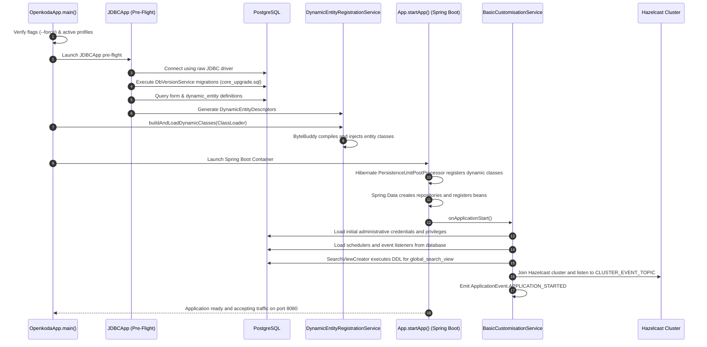
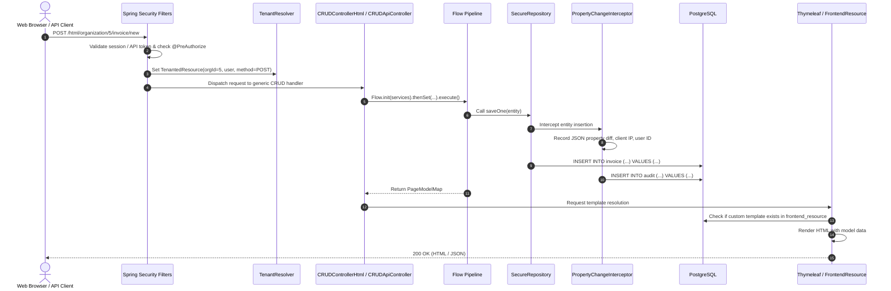
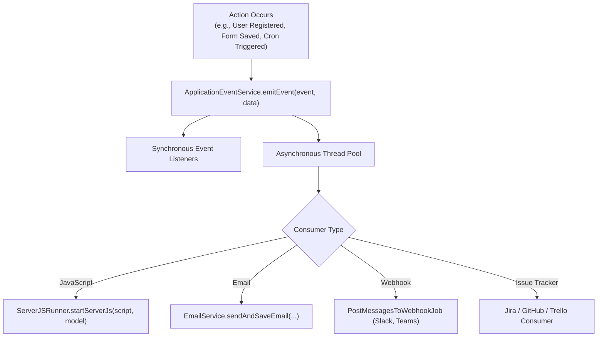
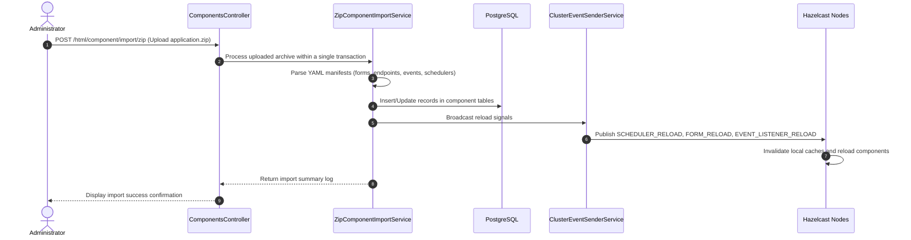

# Openkoda — Overall Functioning & Operational Lifecycle

This document describes the end-to-end operation, bootstrapping lifecycle, request flows, and operational procedures of Openkoda.

---

## 1. System Bootstrapping & Lifecycle

Openkoda uses a multi-phase initialization pipeline to support runtime bytecode compilation and dynamic entities:

---

## 2. HTTP Request Lifecycle (Generic CRUD Flow)

When an authenticated user accesses or submits a dynamic CRUD entity:

---

## 3. Dynamic Event Dispatching & Asynchronous Consumers

Openkoda provides an asynchronous event bus that connects system actions with notification channels and integrations:

---

## 4. Component Packaging & Hot Migration Flow

Openkoda applications can be exported and imported as ZIP archives without redeploying code:

---

## 5. Hot Application Restart Mechanism

When dynamic entity schemas change (new database columns added or modified), Openkoda provides a programmatic restart mechanism without terminating the JVM process:

1. Admin clicks **Save & Apply** in the Data Model Builder.
2. The controller calls [`App.restart(reloadAllForms = true)`](file:///home/jksingh/openkoda/openkoda/src/main/java/com/openkoda/App.java).
3. A background non-daemon thread:
   - Fetches all current `Form` definitions from the database.
   - Gracefully closes the active Spring `ConfigurableApplicationContext`.
   - Invokes [`DynamicEntityRegistrationService.generateDynamicEntityDescriptors(...)`](file:///home/jksingh/openkoda/openkoda/src/main/java/com/openkoda/service/dynamicentity/DynamicEntityRegistrationService.java).
   - Re-synthesizes and injects modified classes into the ClassLoader via ByteBuddy.
   - Re-launches the Spring application context using `SpringApplicationBuilder`.
4. The application is completely updated with the new schema in a few seconds.
