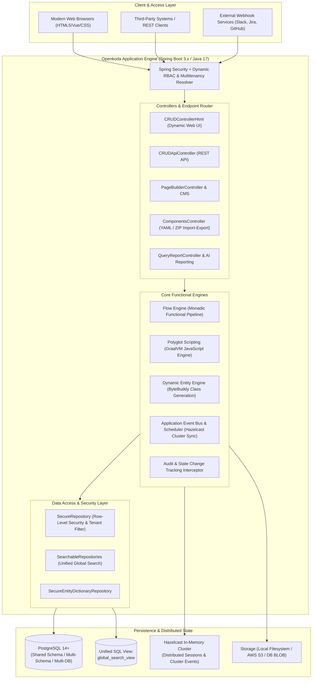
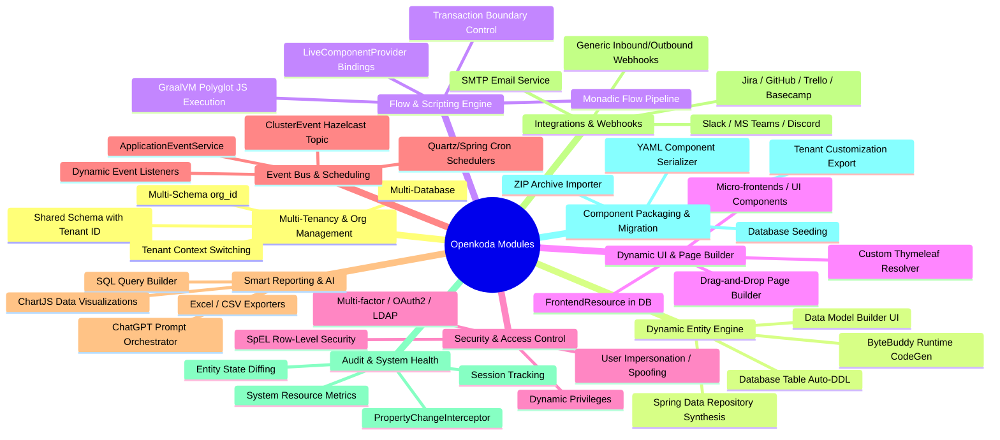
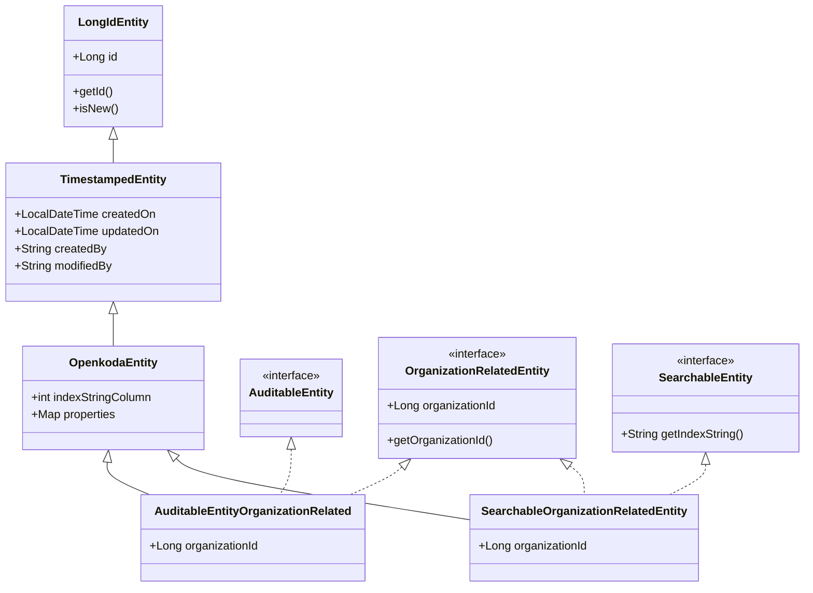
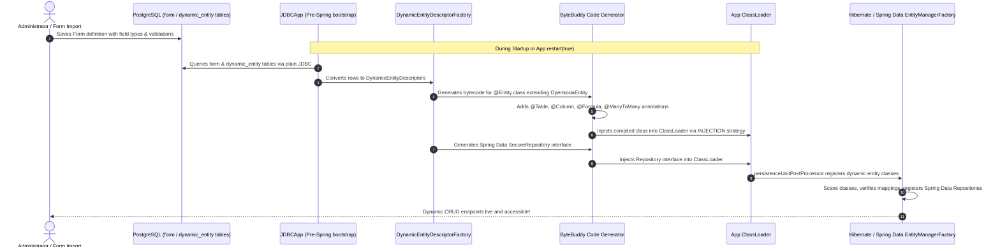
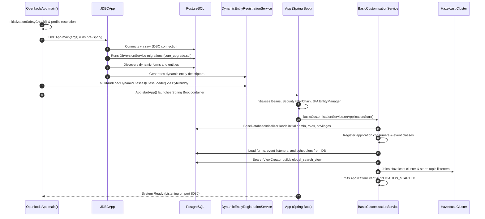
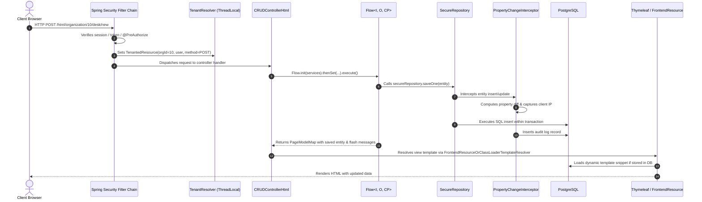
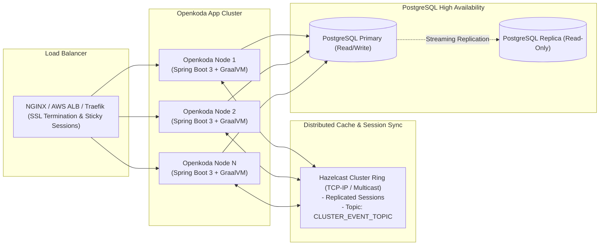

# Openkoda Platform — Reference Architecture Document

---

## 1. Executive Summary & Product Vision

**Openkoda** is an open-source, enterprise-grade, low-code application development platform built on modern **Java 17**, **Spring Boot 3.x**, and **PostgreSQL**. Its primary objective is to accelerate the delivery of business software, multi-tenant SaaS products, and internal tools by up to 60%, eliminating repetitive boilerplate development while retaining total architectural flexibility and avoiding vendor lock-in.

Unlike closed low-code tools that generate rigid proprietary runtimes or restrictive drag-and-drop lock-in, Openkoda combines:
1. **Low-Code Speed**: Runtime dynamic entity creation, visual page builders, server-side polyglot JavaScript scripting, YAML-based component export/import, and dynamic Thymeleaf UI templates.
2. **Pro-Code Extensibility**: Standard Java 17 and Spring Boot codebase, full JPA/Hibernate 6 support, ByteBuddy-based bytecode generation, REST API generation, Hazelcast clustering, and Docker-first deployment.



---

## 2. Technology Stack & Key Dependencies

| Layer / Concern | Technology | Purpose in Openkoda |
| :--- | :--- | :--- |
| **Language Runtime** | Java 17 | Core runtime ensuring LTS language features, records, pattern matching, and performance. |
| **Application Framework** | Spring Boot 3.0.5 | Dependency injection, auto-configuration, MVC, transactions, and actuators. |
| **ORM / Persistence** | Hibernate 6.x & Spring Data JPA | Relational mapping, custom SQL statement inspectors, session-scoped audit interceptors. |
| **Bytecode Engineering** | ByteBuddy 1.12+ | On-the-fly generation of JPA `@Entity` classes and `@Repository` interfaces for dynamic entities. |
| **Scripting Runtime** | GraalVM Polyglot JS (22.3.1) | Execution of server-side JavaScript for business logic, flows, and event listeners. |
| **Template Engine** | Thymeleaf 3.1 + SpringSecurity6 + Layout Dialect | Server-side HTML rendering with dynamic DB-backed template resolution (`FrontendResource`). |
| **Clustering & Cache** | Hazelcast 5.x (`spring-session-hazelcast`) | Distributed session replication and cluster-wide event broadcasting across nodes. |
| **Database** | PostgreSQL 14+ | Relational data store supporting multi-tenancy (schemas/databases) and JSON storage. |
| **Spatial Data** | Hibernate Spatial & Vividsolutions JTS | Geospatial types and GIS point parsing. |
| **Document Generation** | Flying Saucer (iText5) & Apache Commons CSV | Server-side PDF rendering from HTML/CSS and CSV/Excel import-export. |
| **AI Integration** | TheoKanning OpenAI GPT-3/4 Client | Natural language to SQL query generation ("Reporting AI") and prompt orchestration. |
| **External Integrations** | Apache HttpClient, Force API, Spring Social | Connectors for Jira, GitHub, Trello, Basecamp, Slack, MS Teams, Salesforce, and LDAP. |

---

## 3. Repository & Folder Structure Analysis

The Openkoda repository is structured as a Maven multi-module ecosystem, container deployment assets, documentation, and example applications:

```
/home/jksingh/openkoda/
├── doc/                                # System Architecture & Reference Documentation
│   ├── README.md                       # Documentation Suite Index
│   ├── REFERENCE_ARCHITECTURE.md       # Master Reference Architecture Document
│   ├── MODULES.md                      # Detailed Functional Module Breakdown
│   ├── TECHNICAL_DESIGN.md             # Technical Design & Low-Level Architecture
│   └── OVERALL_FUNCTIONING.md          # Lifecycle, Flows & Operational Runtime
├── docker/                             # Containerization and orchestration
│   ├── Dockerfile                      # Production multi-stage Docker build
│   ├── docker-compose.yaml             # Complete stack with PostgreSQL + Openkoda
│   ├── docker-compose-no-db.yaml       # Stack connecting to external PostgreSQL
│   └── entrypoint.sh                   # Startup script with profile initialization
├── examples/                           # Application templates & extensions
│   ├── insurance/                      # Packaged template: Embedded Insurance (insurance.zip)
│   └── timelog/                        # Full Java extension project extending Openkoda App
├── openkoda-app/                       # Master Parent POM
│   └── pom.xml                         # Manages dependencies, build plugins, test suites
├── openkoda/                           # Core Platform Engine (Spring Boot application module)
│   ├── pom.xml                         # Application build config & JAR packaging
│   ├── doc/                            # Existing module docs (admin, app-development, installation)
│   └── src/
│       ├── main/java/com/openkoda/     # Java application source code
│       │   ├── App.java                # Spring Boot App bootstrap, dynamic restart logic
│       │   ├── JDBCApp.java            # Pre-Spring JDBC migration & entity discovery
│       │   ├── OpenkodaApp.java        # Main launcher coordinating JDBCApp -> ByteBuddy -> App
│       │   ├── controller/             # Web controllers (HTML, REST, Admin, PageBuilder)
│       │   ├── core/                   # Platform core infrastructure (Flow, Security, Audit, Multitenancy)
│       │   ├── dto/                    # Data transfer objects across layers
│       │   ├── form/                   # Form definition models and HTML UI binders
│       │   ├── integration/            # Third-party integration consumers & webhooks
│       │   ├── model/                  # JPA entities, base classes, component entities
│       │   ├── repository/             # Spring Data repositories & secure repository layer
│       │   ├── service/                # Business services (dynamic entities, AI, export, users)
│       │   └── uicomponent/            # UI components, LiveComponentProvider, GraalVM bridge
│       └── main/resources/             # Configuration, migrations, and UI templates
│           ├── application-openkoda.properties  # Base configuration
│           ├── components/             # Out-of-the-box frontend components (global, org, public)
│           ├── db/init.sql             # Base schema and sequences
│           ├── migration/              # Versioned SQL migration scripts
│           └── templates/              # Base Thymeleaf templates and XML resolvers
└── scripts/                            # Operational helper scripts
    ├── ok-build.sh                     # Build Openkoda JAR
    ├── ok-db-init.sh                   # Initialize PostgreSQL schema
    ├── ok-run.sh                       # Start Openkoda application
    ├── ok-test-cucumber.sh             # Run end-to-end Cucumber BDD tests
    └── ok-test-junit.sh                # Run JUnit unit and integration tests
```

---

## 4. Platform Modules & Functional Architecture

Openkoda decomposes enterprise software requirements into 10 modular functional subsystems:



### 4.1. Multi-Tenant Organization & User Management Module
* **Package**: [`com.openkoda.core.multitenancy`](file:///home/jksingh/openkoda/openkoda/src/main/java/com/openkoda/core/multitenancy), [`com.openkoda.model`](file:///home/jksingh/openkoda/openkoda/src/main/java/com/openkoda/model)
* **Functionality**:
  * Hierarchical user organization: Users belong to one or more Organizations (`Organization`, `UserRole`, `GlobalOrganizationRole`).
  * Supports 3 multi-tenancy models:
    1. **Shared Schema (Discriminator)**: Records contain `organization_id` foreign key. Query-level isolation enforced by Spring Security SpEL rules.
    2. **Separate Schema (PostgreSQL Schemas)**: Each organization receives its own PostgreSQL schema (e.g., `org_101`). Tables are replicated without constraints via `MultitenancyService.createTenant()`.
    3. **Separate Database**: Physical database separation per tenant managed through datasource routing.
  * Thread-local context tracking via `TenantResolver.TenantedResource` keeps track of active organization, user, HTTP method, and preselected datasource index.

### 4.2. Dynamic Data Model & Low-Code Entity Engine
* **Package**: [`com.openkoda.service.dynamicentity`](file:///home/jksingh/openkoda/openkoda/src/main/java/com/openkoda/service/dynamicentity), [`com.openkoda.model.DynamicEntity`](file:///home/jksingh/openkoda/openkoda/src/main/java/com/openkoda/model/DynamicEntity.java)
* **Functionality**:
  * Allows administrators to define new database tables, fields, validations, and relations through the UI or YAML definitions without touching Java source files.
  * Supported data types: text, numbers, dates, times, booleans, dropdowns, code snippets (HTML/CSS/JS), file attachments, coordinates (`Point`), and foreign keys (`FieldType`).
  * Utilizes **ByteBuddy** to dynamically synthesize real compiled Java bytecode classes implementing `OpenkodaEntity` and Spring Data JPA `SecureRepository`.
  * Dynamically modifies Hibernate's `PersistenceUnitPostProcessor` to register new classes into the JPA metamodel before Spring's `EntityManagerFactory` initializes.

### 4.3. Flow Engine & Polyglot Server-side Scripting
* **Package**: [`com.openkoda.core.flow`](file:///home/jksingh/openkoda/openkoda/src/main/java/com/openkoda/core/flow), [`com.openkoda.uicomponent.JsFlowRunner`](file:///home/jksingh/openkoda/openkoda/src/main/java/com/openkoda/uicomponent/JsFlowRunner.java), [`com.openkoda.core.customisation.ServerJSRunner`](file:///home/jksingh/openkoda/openkoda/src/main/java/com/openkoda/core/customisation/ServerJSRunner.java)
* **Functionality**:
  * **Flow Monad**: Implements a functional, monadic request processing pipeline `Flow<I, O, CP>`. Chains validation, data fetching, business modifications, and view model generation in pure functions with automatic transaction propagation (`TransactionalExecutor`).
  * **Polyglot JavaScript Runtime**: Uses **GraalVM** to execute JavaScript logic on the server with direct, sandboxed access to Java Spring beans via `LiveComponentProvider`.
  * Exposes rich execution context (`flow`, `context`, `services`, `dateNow`, `parseJSON`, `repositories`) directly into server-side scripts.

### 4.4. Dynamic UI, Page Builder & Frontend Resource Engine
* **Package**: [`com.openkoda.core.service.FrontendResourceService`](file:///home/jksingh/openkoda/openkoda/src/main/java/com/openkoda/core/service/FrontendResourceService.java), [`com.openkoda.controller.PageBuilderController`](file:///home/jksingh/openkoda/openkoda/src/main/java/com/openkoda/controller/PageBuilderController.java)
* **Functionality**:
  * Dual-mode UI rendering: Loads HTML templates from filesystem/classpath or dynamically from the database (`frontend_resource` table).
  * Custom Thymeleaf template resolver (`FrontendResourceOrClassLoaderTemplateResolver`) intercepts view lookups and renders templates modified through the Admin UI.
  * Drag-and-drop page builder for creating customized organization dashboards, form layouts, and dynamic widgets without code deployments.
  * Scoped access levels: `PUBLIC` (unauthenticated pages), `ORGANIZATION` (scoped to tenant), and `GLOBAL` (system administration).

### 4.5. Security, RBAC & Row-Level Authorization Module
* **Package**: [`com.openkoda.core.security`](file:///home/jksingh/openkoda/openkoda/src/main/java/com/openkoda/core/security), [`com.openkoda.model.Privilege`](file:///home/jksingh/openkoda/openkoda/src/main/java/com/openkoda/model/Privilege.java)
* **Functionality**:
  * Fine-grained Role-Based Access Control (RBAC) supporting static privileges (`PrivilegeNames`) and user-defined runtime privileges (`DynamicPrivilege`).
  * Integrated Spring Security filters:
    * `LoginAndPasswordAuthenticationFilter`: Standard web authentication.
    * `ApiTokenHeaderAuthenticationFilter`: Header-based REST API authentication (`X-Auth-Token`).
    * `TokenPathPrefixAuthenticationFilter` & `RequestParameterTokenAuthenticationFilter`: Token-based access for webhooks and downloads.
  * Method-level and query-level security using SpEL expressions (`@PreAuthorize(CHECK_CAN_MANAGE_ORG_DATA)`).
  * User Impersonation / Spoofing (`CHECK_IS_SPOOFED`, `RunAsService`) allows administrators to safely debug issues under a target user's identity.

### 4.6. Event-Driven Architecture, Task Scheduler & Clustering Module
* **Package**: [`com.openkoda.core.service.event`](file:///home/jksingh/openkoda/openkoda/src/main/java/com/openkoda/core/service/event), [`com.openkoda.core.job`](file:///home/jksingh/openkoda/openkoda/src/main/java/com/openkoda/core/job)
* **Functionality**:
  * Publish-subscribe internal event bus (`ApplicationEventService`) broadcasting events (e.g., entity creation, user signup, cron trigger).
  * Distributed synchronization via **Hazelcast** (`ClusterEventSenderService`, `ClusterEventListenerService`): Node-to-node replication of scheduler reloading, listener updates, and cache invalidation.
  * Dynamic cron scheduling (`SchedulerService`, `Scheduler`) stored in PostgreSQL and scheduled via Spring task executors.

### 4.7. Smart Reporting, SQL Engine & AI Assistant Module
* **Package**: [`com.openkoda.controller.report`](file:///home/jksingh/openkoda/openkoda/src/main/java/com/openkoda/controller/report), [`com.openkoda.service.openai`](file:///home/jksingh/openkoda/openkoda/src/main/java/com/openkoda/service/openai)
* **Functionality**:
  * SQL Reporting: Allows authorized users to write custom SQL queries against the relational schema and expose results as tabular grids, ChartJS visualizations, or downloadable Excel/CSV files.
  * **Reporting AI**: Integrates with OpenAI GPT-3/4. System extracts schema definitions (`ChatGPTPromptService`) and prompts the model to generate SQL queries from natural language prompts without transmitting raw customer data externally.

### 4.8. Integration & Webhook Ecosystem
* **Package**: [`com.openkoda.integration`](file:///home/jksingh/openkoda/openkoda/src/main/java/com/openkoda/integration), [`com.openkoda.core.service.GenericWebhookService`](file:///home/jksingh/openkoda/openkoda/src/main/java/com/openkoda/core/service/GenericWebhookService.java)
* **Functionality**:
  * Pre-built integration consumers:
    * **Slack & MS Teams**: Inbound and outbound notifications.
    * **Jira & GitHub**: Automatic issue/ticket creation on system events.
    * **Trello & Basecamp**: Task and board synchronization.
    * **Salesforce, Google, Facebook, LinkedIn**: Identity federation and contact sync.
  * Inbound webhook handler dispatching payloads directly into server-side JavaScript flows or Java consumers.

### 4.9. Full Audit Trail, Logging & System Health Monitoring
* **Package**: [`com.openkoda.core.audit`](file:///home/jksingh/openkoda/openkoda/src/main/java/com/openkoda/core/audit), [`com.openkoda.controller.admin`](file:///home/jksingh/openkoda/openkoda/src/main/java/com/openkoda/controller/admin)
* **Functionality**:
  * Session-scoped Hibernate interceptor (`PropertyChangeInterceptor`) intercepts entity modifications.
  * Compares old vs new state and records JSON diffs in the `audit` table, tracking changed properties, modifying user, timestamp, and IP address.
  * Real-time system health checks (`SystemHealthStatus`, `SystemHealthAlertJob`) tracking memory, disk usage, active database connections, and background thread pools.

### 4.10. Application Component Packaging & Import/Export Engine
* **Package**: [`com.openkoda.controller.ComponentsController`](file:///home/jksingh/openkoda/openkoda/src/main/java/com/openkoda/controller/ComponentsController.java), [`com.openkoda.service.export`](file:///home/jksingh/openkoda/openkoda/src/main/java/com/openkoda/service/export)
* **Functionality**:
  * Full application serialization into a single ZIP archive containing YAML component manifests (`forms.yaml`, `endpoints.yaml`, `events.yaml`, `schedulers.yaml`) and raw template/script files.
  * Enables zero-downtime application updates, template migrations between environments (Dev -> Staging -> Prod), and complete application distribution (e.g., Insurance, Timelog templates).

---

## 5. Technical Design & Layered Architecture

Openkoda implements a 5-tier enterprise architectural pattern:

```
┌────────────────────────────────────────────────────────────────────────┐
│                        1. Presentation Layer                           │
│  - Thymeleaf View Engine + Dynamic Template Resolver                   │
│  - Vue.js / Bootstrap Micro-Components / Page Builder Canvas          │
│  - REST API (OpenAPI / Swagger documentation)                          │
└───────────────────────────────────┬────────────────────────────────────┘
                                    │ HTTP / WebSocket / JSON
┌───────────────────────────────────▼────────────────────────────────────┐
│                        2. Controller Layer                             │
│  - CRUDControllerHtml & CRUDApiController (Dynamic Endpoint Handlers)  │
│  - AdminLogs, Integrations, Organization, User, Component Controllers  │
│  - Dynamic URL Routing: /html/organization/{orgId}/{obj}/...           │
└───────────────────────────────────┬────────────────────────────────────┘
                                    │ Flow Initializer & Request Context
┌───────────────────────────────────▼────────────────────────────────────┐
│                    3. Business Logic & Flow Layer                      │
│  - Monadic Flow Pipeline (Flow.init().thenSet(...).execute())          │
│  - GraalVM Polyglot JavaScript Execution (ServerJSRunner, JsFlowRunner)│
│  - ApplicationEventService & Hazelcast Event Cluster Broadcaster      │
│  - LiveComponentProvider (Bridge exposing Spring beans to JS scripts)  │
└───────────────────────────────────┬────────────────────────────────────┘
                                    │ Query Specifications & Security Scope
┌───────────────────────────────────▼────────────────────────────────────┐
│                    4. Data Access & Security Layer                     │
│  - SecureRepositoryWrapper & SearchableFunctionalRepository            │
│  - Row-Level Tenant Security Filtering via Spring Security SpEL        │
│  - Hibernate Interceptors (AuditInterceptor, PropertyChangeInterceptor)│
│  - Unified Global Search (PostgreSQL global_search_view)               │
└───────────────────────────────────┬────────────────────────────────────┘
                                    │ JDBC / JPA / HikariCP
┌───────────────────────────────────▼────────────────────────────────────┐
│                        5. Persistence Layer                            │
│  - PostgreSQL 14+ (Shared Schema / Multi-Schema / Multi-Database)       │
│  - ByteBuddy Dynamic Entity Tables & Schema Migrations                 │
│  - File Storage (PostgreSQL LOB, Local Filesystem, AWS S3)             │
│  - Hazelcast In-Memory Distributed Cluster (Sessions & Cluster Topics) │
└────────────────────────────────────────────────────────────────────────┘
```

### 5.1. Entity Inheritance & Base Models
All data models in Openkoda derive from a consistent base hierarchy:



### 5.2. ByteBuddy Dynamic Entity Compilation Flow
The core differentiator of Openkoda's data modeling engine is runtime class generation:



### 5.3. Unified Global Search Architecture
Instead of requiring an external Elasticsearch cluster for simple search, Openkoda constructs a unified SQL view:
1. `SearchViewCreator` inspects all registered `SearchableRepositories` on startup.
2. Extracts entity metadata, path formulas, search index formulas, and required read privileges.
3. Generates a dynamic PostgreSQL database view:
   ```sql
   CREATE OR REPLACE VIEW global_search_view AS 
     (SELECT id, 'user' as name, organization_id, created_on, updated_on, 
             (first_name || ' ' || last_name) as description, 
             'readUserData' as required_read_privilege, 
             ('/html/organization/' || organization_id || '/user/' || id) as urlPath 
      FROM users)
     UNION
     (SELECT id, 'organization' as name, id as organization_id, created_on, updated_on, 
             name as description, 
             'readOrgData' as required_read_privilege, 
             ('/html/organization/' || id || '/settings') as urlPath 
      FROM organization)
     UNION ... (all searchable static & dynamic entities);
   ```
4. `GlobalSearchController` queries this single view with user privileges and organization context, delivering instant, permission-filtered global search across the entire application.

---

## 6. End-to-End Execution Flows & Lifecycle

### 6.1. System Startup Sequence



### 6.2. Web Request Execution Pipeline (Flow Engine)



---

## 7. Extension & Developer Workflow

Developers can build enterprise applications on top of Openkoda in two ways:

### Pattern A: Low-Code UI Extension (No Compilation)
1. **Model Building**: Define entities in **Configuration > Forms / Data Model** with desired fields (text, numbers, files, relations).
2. **Business Logic**: Attach server-side JavaScript to endpoints (`/html/webEndpoint`) or background schedulers (`/html/scheduler`).
   ```javascript
   // Server-side JavaScript accessing LiveComponentProvider
   flow.thenSet("lead", a => {
       let orgId = a.model.get("organizationEntityId");
       let leadData = a.model.get("params").get("dto");
       return a.services.data.saveLead(orgId, leadData);
   });
   ```
3. **UI Layouts**: Construct custom HTML/Thymeleaf pages in **Frontend Resources** or visually arrange dashboard widgets using the **Page Builder**.
4. **Portability**: Click **Configuration > Import/Export** to download the entire application package as a ZIP archive.

### Pattern B: Full Java / Spring Boot Extension (Pro-Code)
1. Add Openkoda as a Maven parent dependency:
   ```xml
   <parent>
       <groupId>com.openkoda</groupId>
       <artifactId>openkoda-app</artifactId>
       <version>1.7.1</version>
   </parent>
   <dependencies>
       <dependency>
           <groupId>com.openkoda</groupId>
           <artifactId>openkoda</artifactId>
           <version>1.7.1</version>
       </dependency>
   </dependencies>
   ```
2. Inherit from `com.openkoda.App`:
   ```java
   @SpringBootApplication(scanBasePackages = {"com.openkoda", "com.mycompany.app"})
   @EnableJpaRepositories({"com.openkoda", "com.mycompany.app.repository"})
   @EntityScan({"com.openkoda", "com.mycompany.app.model"})
   public class MyEnterpriseApp extends App {
       public static void main(String[] args) {
           startApp(MyEnterpriseApp.class, args);
       }
   }
   ```
3. Create standard JPA entities extending `SearchableOrganizationRelatedEntity` or `AuditableEntityOrganizationRelated`.
4. Register custom forms, event listeners, and CRUD controllers via `CustomisationService` inside an `@PostConstruct` bean lifecycle method.

---

## 8. Deployment, Scaling & Operational Architecture



* **Zero-Downtime Entity Reloading**: Dynamic entity reloading and form definitions broadcast via Hazelcast topic `CLUSTER_EVENT_TOPIC` across all active nodes without cluster-wide cold restarts.
* **Database Migration & Versioning**: Managed using `DbVersionService` via sequential upgrade scripts in `/migration/core_upgrade.sql`.
* **Automated Backup**: Native backup service (`BackupService`) orchestrates PostgreSQL `pg_dump`, optional GPG encryption, and automated offsite transport via SCP / AWS S3.
* **Security Hardening**: Secure cookie configurations (`SECURE_COOKIE`), CSRF prevention, strict CSP headers, SQL statement inspection, and sanitization via JSoup.
