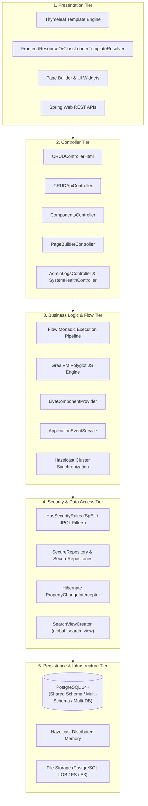
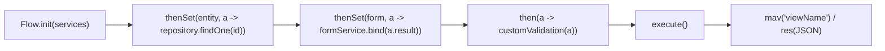
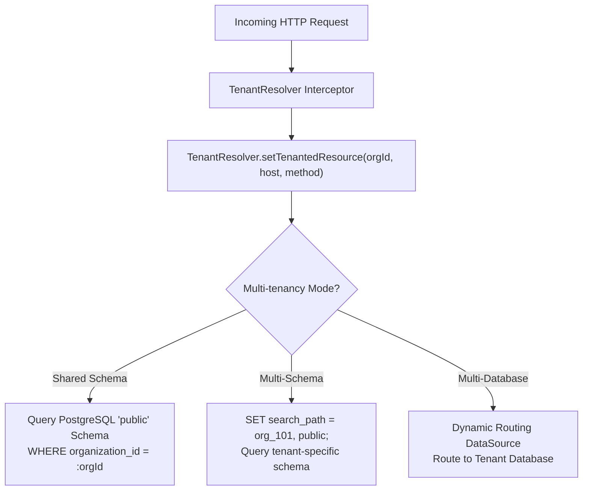

# Openkoda — Technical Design & Low-Level Architecture

This document details the core technical design, execution patterns, and data architecture of the Openkoda platform.

---

## 1. Five-Tier Architectural Pattern



---

## 2. Dynamic Bytecode Generation with ByteBuddy

One of Openkoda's key technical innovations is avoiding generic "key-value EAV (Entity-Attribute-Value)" anti-patterns for dynamic entities. Instead, Openkoda synthesizes real Java bytecode classes and genuine PostgreSQL tables at runtime.

### Bytecode Compilation Pipeline
1. **Form Definitions**: Administrators create entities with fields via the UI.
2. **Descriptor Generation**: [`DynamicEntityDescriptorFactory.create(...)`](file:///home/jksingh/openkoda/openkoda/src/main/java/com/openkoda/service/dynamicentity/DynamicEntityDescriptorFactory.java) defines table names, column types, and formula fields.
3. **ByteBuddy Entity Synthesis**:
   ```java
   // From DynamicEntityRegistrationService.java
   DynamicType.Builder<OpenkodaEntity> builder = new ByteBuddy()
       .subclass(OpenkodaEntity.class)
       .name("com.openkoda.dynamicentity.generated." + suffixedEntityClassName)
       .annotateType(AnnotationDescription.Builder.ofType(Entity.class).build())
       .annotateType(AnnotationDescription.Builder.ofType(Table.class)
           .define("name", tableName).build());
   ```
4. **Field & Annotation Injection**: ByteBuddy generates getter/setter methods and injects annotations (`@Column`, `@Formula`, `@JoinColumn`, `@ManyToMany`).
5. **Class Loading**: Unloaded classes are loaded into the running JVM using `ClassLoadingStrategy.Default.INJECTION`.
6. **Repository Synthesis**: ByteBuddy creates a dynamic subinterface of [`SecureRepository`](file:///home/jksingh/openkoda/openkoda/src/main/java/com/openkoda/repository/SecureRepository.java).
7. **JPA Integration**: Openkoda's `persistenceUnitPostProcessor()` adds all dynamic entity class names to Spring's `PersistenceUnitInfo`, enabling Hibernate and Spring Data JPA to bind them as native entities.

---

## 3. The Flow Monad & Functional Pipeline

Web controller methods in Openkoda avoid procedural, boilerplate-heavy service calls in favor of a functional, monadic request pipeline implemented in [`Flow<I, O, CP>`](file:///home/jksingh/openkoda/openkoda/src/main/java/com/openkoda/core/flow/Flow.java).



### Key Technical Characteristics of Flow
- **Immutable Result Propagation**: Each `then()` or `thenSet()` step receives a [`ResultAndModel`](file:///home/jksingh/openkoda/openkoda/src/main/java/com/openkoda/core/flow/ResultAndModel.java) containing the current step result, the accumulated `PageModelMap`, and injected Spring services.
- **Transactional Boundary Management**: Steps wrapped with transactional executors commit or roll back automatically upon exceptions.
- **Bi-Directional Polyglot Support**: The same `Flow` interface is exposed into GraalVM JavaScript, allowing scripts to chain Java Spring operations:
  ```javascript
  flow
    .thenSet("lead", a => a.services.data.findLead(a.model.get("id")))
    .then(a => a.services.email.sendNotification(a.result));
  ```

---

## 4. Multi-Tenancy Architecture & Query Routing

Openkoda implements flexible multi-tenancy at both the persistence and application layer.



### Automatic Tenant Security via SpEL
In shared-schema mode, queries are automatically isolated using Spring Security SpEL rules:
```java
// Example from HasSecurityRules.java
String CHECK_CAN_READ_ORG_DATA = 
    "principal.hasGlobalOrOrgPrivilege('readOrgData', #organizationId)";
```
Repositories extending [`SecureRepository`](file:///home/jksingh/openkoda/openkoda/src/main/java/com/openkoda/repository/SecureRepository.java) apply JPA criteria specifications that constrain result sets to the authenticated user's organization IDs.

---

## 5. Unified Global Search Architecture

Instead of adding the operational complexity of Elasticsearch, Openkoda constructs a unified SQL view at application startup:

1. [`SearchViewCreator`](file:///home/jksingh/openkoda/openkoda/src/main/java/com/openkoda/core/lifecycle/SearchViewCreator.java) inspects all registered [`SearchableRepositories`](file:///home/jksingh/openkoda/openkoda/src/main/java/com/openkoda/repository/SearchableRepositories.java).
2. It extracts search metadata, URL path formulas, and required read privileges for each entity.
3. Generates a dynamic PostgreSQL database view:
   ```sql
   CREATE OR REPLACE VIEW global_search_view AS 
     (SELECT id, 'user' as name, organization_id, created_on, updated_on, 
             (first_name || ' ' || last_name) as description, 
             'readUserData' as required_read_privilege, 
             ('/html/organization/' || organization_id || '/user/' || id) as urlPath 
      FROM users)
     UNION
     (SELECT id, 'organization' as name, id as organization_id, created_on, updated_on, 
             name as description, 
             'readOrgData' as required_read_privilege, 
             ('/html/organization/' || id || '/settings') as urlPath 
      FROM organization)
     UNION ... (all searchable static & dynamic entities);
   ```
4. Single-query execution: [`GlobalSearchController`](file:///home/jksingh/openkoda/openkoda/src/main/java/com/openkoda/controller/GlobalSearchController.java) queries `global_search_view` using standard SQL `ILIKE` or full-text operators, enforcing tenant boundaries and read privileges in a single query.

---

## 6. Hazelcast Clustering & State Synchronization

In multi-node deployments, Openkoda nodes communicate via an embedded **Hazelcast 5.x** cluster.

1. **Distributed Sessions**: User web sessions are replicated across cluster nodes via `spring-session-hazelcast`.
2. **Cluster Topic (`CLUSTER_EVENT_TOPIC`)**:
   - When an administrator modifies a form, scheduler, or event listener on Node 1, [`ClusterEventSenderService`](file:///home/jksingh/openkoda/openkoda/src/main/java/com/openkoda/core/service/event/ClusterEventSenderService.java) broadcasts a [`ClusterEvent`](file:///home/jksingh/openkoda/openkoda/src/main/java/com/openkoda/core/service/event/ClusterEvent.java) to the topic.
   - Node 2..N receive the message via [`ClusterEventListenerService`](file:///home/jksingh/openkoda/openkoda/src/main/java/com/openkoda/core/service/event/ClusterEventListenerService.java) and reload the definition locally in memory without restart.
