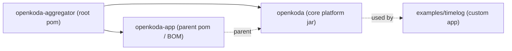
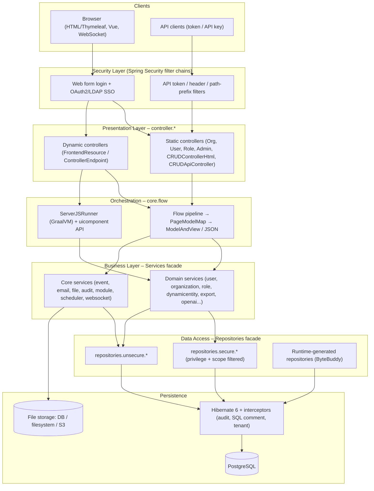
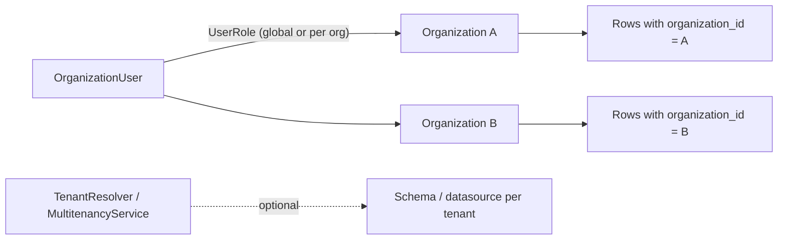
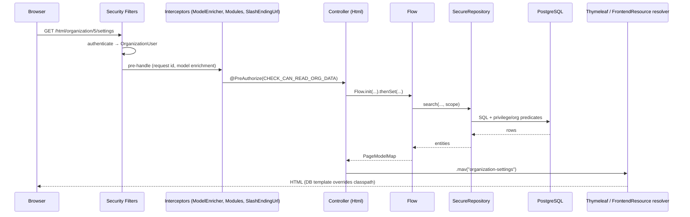
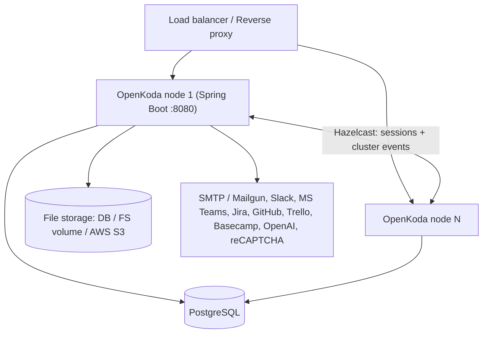

# OpenKoda – Reference Architecture (2nd Analysis)

> Based on a direct analysis of the repository layout, build files, configuration and the
> `openkoda/src` source tree (≈623 main Java classes, 38 test classes, version **1.7.1**).

---

## 1. Executive Summary

OpenKoda is a **multi-tenant, low-code enterprise application platform** built as a
**modular monolith** on **Spring Boot 3 / Java 17+**, **Hibernate 6 / JPA**, **PostgreSQL**,
**Thymeleaf** server-side rendering and an embedded **GraalVM JavaScript** engine.

Its reference architecture can be summarised as:

| Aspect | Architectural choice |
|---|---|
| Deployment style | Modular monolith (single Spring Boot WAR/JAR), horizontally scalable via Hazelcast |
| Logical style | Layered (Controller → Flow → Service → Secure Repository → Entity) |
| Presentation | Server-side MVC (Thymeleaf) + REST API (v1/v2) + WebSocket |
| Extensibility | **Metadata-driven low-code**: forms, entities, endpoints, pages, scripts and schedulers are stored in the DB and loaded at runtime |
| Tenancy | Organization-based multi-tenancy (row-level `organization_id`, optional schema-per-tenant) |
| Security | Spring Security with multiple filter chains + privilege-based, scope-aware data access in the repository layer |
| Integration | Event bus (application + cluster events), webhooks, Slack/MS Teams, Jira/GitHub/Trello/Basecamp, OpenAI |

---

## 2. Repository / Folder Structure

```text
openkoda/                          ← Git root, Maven aggregator (openkoda-aggregator)
├── pom.xml                        ← <modules>: openkoda-app, openkoda
├── README.md, LICENSE (MIT)
├── doc/                           ← Architecture & design documentation
├── docker/                        ← Dockerfile, docker-compose(.yaml / -no-db), entrypoint.sh
├── scripts/                       ← ok-build, ok-db-init, ok-run, ok-test-junit, ok-test-cucumber
├── examples/
│   ├── timelog/                   ← Sample app extending the core (models, repos, REST APIs)
│   └── insurance/insurance.zip    ← Importable low-code component package
├── openkoda-app/                  ← Parent POM (Spring Boot parent, dependency management)
└── openkoda/                      ← THE CORE PLATFORM MODULE
    ├── pom.xml                    ← main class: com.openkoda.OpenkodaApp
    ├── build/, etc/, doc/img/
    └── src/
        ├── main/java/             ← com.openkoda.* (+ small reactor.util.function extension)
        ├── main/resources/        ← config, templates, SQL, static assets, i18n
        └── test/                  ← JUnit + Cucumber/Selenide BDD tests
```

### 2.1 Maven module relationship



`openkoda-app` acts as the **parent/BOM** (Spring Boot starter parent, dependency versions);
`openkoda` contains all code. Custom applications (e.g. `examples/timelog`) depend on the
core and add their own entities, repositories and controllers.

---

## 3. Technology Stack (from `pom.xml`)

| Layer | Technologies |
|---|---|
| Runtime | Spring Boot (web, data-jpa, data-rest, security, websocket, cache, aop, mail, thymeleaf, oauth2-client) |
| Persistence | Hibernate 6, Hypersistence Utils, Hibernate Spatial + JTS, HikariCP, PostgreSQL (H2 for tests) |
| Views | Thymeleaf + Layout Dialect + Spring Security extras, WebJars (Bootstrap, Vue) |
| Scripting | GraalVM Polyglot (`graal-sdk`, `js`, `js-scriptengine`) |
| Code generation | **ByteBuddy**, Javassist (runtime entity/repository class generation) |
| Clustering | Spring Session Hazelcast |
| Auth | Spring Security, LDAP, OAuth2 (Google, Facebook, LinkedIn, Salesforce), API keys/tokens |
| Docs/API | springdoc-openapi (Swagger UI), Spring Data REST HAL browser |
| Documents | Flying Saucer PDF (iText5), Commons CSV, Jackson XML, Jsoup |
| Cloud | AWS SDK S3 (file storage) |
| Testing | JUnit 5, Mockito, Spring Security Test, Cucumber, Selenium/Selenide |
| Quality | JaCoCo, PMD, FindBugs, JSHint, git-commit-id plugin |

---

## 4. Source Code Structure (`openkoda/src/main/java/com/openkoda`)

| Package | Responsibility | Representative classes |
|---|---|---|
| *(root)* | Bootstrap | `App`, `OpenkodaApp`, `JDBCApp` |
| `controller` | Web layer (HTML + API) | `CRUDControllerHtml`, `DashboardController`, `PageBuilderController`, `ComponentsController`, `PublicController`, `GlobalSearchController`, `ComponentProvider`, `Controllers` |
| `controller.admin` | Admin console | Audit, Logs, Integrations, SystemHealth controllers |
| `controller.api` (`auth`,`v1`,`v2`) | REST API | `CRUDApiController`, `TokenControllerApiV1`, `OrganizationControllerApi`, `ServerJsControllerApi`, `FrontendResourceControllerApi` |
| `controller.frontendresource` | Runtime pages & custom endpoints | `PublicFrontendResourceController`, `RestrictedFrontendResourceController`, `FrontendResourceAssetController` |
| `controller.{organization,user,role,file,notification,report}` | Domain controllers (Abstract* + *Html pairs) | `AbstractOrganizationController`, `UserControllerHtml`, `QueryReportController`, `BasicAIReportController` |
| `core.flow` | **Flow pipeline engine** | `Flow`, `PageModelMap`, `PageAttr`, `ResultAndModel`, `TransactionalExecutor`, `JsFlow` |
| `core.form` | Form/DTO/validation framework | `AbstractForm`, `AbstractEntityForm`, `FrontendMappingDefinition`, `FormFieldDefinitionBuilder`, `ReflectionBasedEntityForm`, `MapEntityForm`, `CRUDControllerConfiguration` |
| `core.security` | Authentication & authorization | `HasSecurityRules`, `OrganizationUser`, `UserProvider`, `RunAsService`, token filters, `ApplicationAwarePasswordEncoder` |
| `core.multitenancy` | Tenant resolution | `MultitenancyService`, `TenantResolver`, `SchemaSupportingConnectionProvider`, `QueryExecutor` |
| `core.audit` | Change tracking | `AuditInterceptor`, `PropertyChangeInterceptor`, `AuditChangeFactory`, `IpService` |
| `core.customisation` | Plug-in/customisation SPI, server JS | `CustomisationService`, `BasicCustomisationService`, `ServerJSRunner`, `FrontendMappingMap`, `CoreSettledEvent` |
| `core.service.*` | Technical services | `event` (`ApplicationEventService`, `ClusterEvent*`, `SchedulerService`), `email` (SMTP/Mailgun), `backup`, `module`, `pdf`, `form`, `system` |
| `core.configuration` | Spring configuration | `WebSecurityConfig`, `MvcConfig`, `WebSocketConfig`, `JobConfig`, `SwaggerConfig`, `Datasources`, Hazelcast `session.*` |
| `core.job` | Background jobs | `JobsScheduler`, `EmailSenderJob`, `PostMessagesToWebhookJob`, `SearchIndexUpdaterJob`, `SystemHealthAlertJob` |
| `core.repository.common` | Repository base contracts | `FunctionalRepository*`, `ScopedSecureRepository`, `UnscopedSecureRepository` |
| `core.{cache,helper,tracker,exception,lifecycle}` | Cross-cutting | `RequestSessionCacheService`, `ModelEnricherInterceptor`, `RequestIdHolder`, `TrackJobAspect`, `BaseDatabaseInitializer`, `SearchViewCreator` |
| `model` | JPA domain model | `Organization`, `User`, `Role`/`GlobalRole`/`OrganizationRole`, `UserRole`, `Privilege`, `DynamicEntity`, `OpenkodaModule`, `MapEntity` |
| `model.common` | Entity base types | `OpenkodaEntity`, `TimestampedEntity`, `OrganizationRelatedEntity`, `SearchableEntity`, `AuditableEntity`, `ComponentEntity` |
| `model.component` | **Low-code metadata entities** | `Form`, `FrontendResource`, `ControllerEndpoint`, `ServerJs`, `Scheduler` |
| `model.{authentication,file,notification,report,task,module}` | Supporting entities | `LoginAndPassword`, `ApiKey`, `GoogleUser`, `LDAPUser`, `File`, `Notification`, `QueryReport`, `Email`, `HttpRequestTask` |
| `repository.*` | Spring Data repos (unsecure + `Secure*`) | `Repositories` (facade with `secure` / `unsecure`), `SecureRepository`, `SecureRepositoryWrapper`, `specifications.*` |
| `service.*` | Business services | `Services` (facade), `user`, `organization`, `role`, `dynamicentity`, `export` (component import/export), `openai`, `csv`, `map`, `captcha`, `upgrade`, `autocomplete` |
| `integration.*` | 3rd-party integrations | `IntegrationService`, `PushNotificationService`, Jira/GitHub/Trello/Basecamp consumers, integration forms |
| `uicomponent` (+`live`, `annotation`) | **API exposed to server-side JS** | `DataServices`, `MessagesServices`, `SystemServices`, `IntegrationServices`, `OpenAIServices`, `JsFlowRunner`, `LiveComponentProvider` |
| `dto.*` | Transport objects | `OrganizationDto`, `BasicUser`, `NotificationDto`, `payment.*`, `system.*` |
| `form` | Concrete forms | `OrganizationForm`, `RoleForm`, `InviteUserForm`, `FrontendResourceForm`, `SchedulerForm`, `FrontendMappingDefinitions` |

### 4.1 Resources (`src/main/resources`)

| Path | Content |
|---|---|
| `application.properties` / `application-openkoda.properties` / `application-drop_and_init_database.properties` | Profile-based config (`openkoda,local` default; init profile wipes DB) |
| `db/init.sql`, `import.sql` | Initial schema & seed data |
| `migration/core_upgrade.sql`, `upgrade.sql` | Versioned DB upgrades tracked in `db_version` (`DbVersionService`) |
| `templates/` (+`frontend-resource`, `module`, `page`, `xml`) | Thymeleaf views (admin dashboard, generic CRUD `generic-all/settings/view`, org/role/user pages, sitemap XML) |
| `components/`, `components-additional-files/` | Built-in low-code components imported on startup (`ClasspathComponentImportService`) |
| `default-code/` | Templates for new ServerJS/HTML/CSS resources |
| `public/vendor` | Static assets (JS/CSS/logos) |
| `messages*.properties` | i18n (EN, PL) |
| `META-INF/services` | Java SPI registrations |

### 4.2 Tests (`src/test`)

- `java/com/openkoda/**` – JUnit unit/integration tests (flow, form, helper, services, upgrade, map).
- `java/cucumber/**` + `resources/features/{authentication,forms,navigation,tables}` – BDD UI tests (Cucumber + Selenide).

---

## 5. Logical Reference Architecture



### 5.1 Layer responsibilities

1. **Security layer** – `WebSecurityConfig` defines **six `SecurityFilterChain`s**
   (web, public web, API auth, API token, API v1, API v2). Filters include
   `LoginAndPasswordAuthenticationFilter`, `ApiTokenHeaderAuthenticationFilter`,
   `RequestParameterTokenAuthenticationFilter`, `TokenPathPrefixAuthenticationFilter`
   and an SSO filter (OAuth2/LDAP). The principal is `OrganizationUser`, which carries
   global and per-organization privileges.
2. **Presentation layer** – Controllers follow an **`AbstractXxxController` + `XxxControllerHtml` / `XxxControllerApi`** split:
   the abstract class builds a `Flow` (pure business orchestration), the concrete class binds
   HTTP mapping, `@PreAuthorize` checks and renders via `.mav(...)` (HTML) or JSON.
3. **Orchestration (Flow)** – `Flow<I,O,CP>` is a functional, transactional pipeline:
   `Flow.init(...).thenSet(pageAttr, a -> ...).then(...).execute()`. Each step writes typed
   `PageAttr` values into a `PageModelMap`, which becomes the Thymeleaf model or JSON payload.
4. **Business layer** – Accessed through the **`Services` facade** (`services.user`,
   `services.organization`, `services.validation`, ...).
5. **Data access** – Accessed through the **`Repositories` facade**
   (`repositories.secure.*` vs `repositories.unsecure.*`).
6. **Persistence** – Hibernate with `PropertyChangeInterceptor` (audit),
   `SqlCommentStatementInspector`, `TenantResolver` / `SchemaSupportingConnectionProvider`.

---

## 6. Key Architectural Patterns

### 6.1 Component Provider / Service-Locator facades
Every controller and many services extend **`ComponentProvider`**, which injects
`services`, `repositories`, `controllers` and `messages` facades. This gives uniform access to
the whole platform (also re-exposed to server-side JavaScript) at the cost of tighter coupling.

### 6.2 Flow pipeline (functional controller logic)
```java
return Flow.init(this, id)
        .thenSet(organizationEntity, a -> repositories.unsecure.organization.findOne(id))
        .thenSet(organizationForm,  a -> new OrganizationForm(id, a.result))
        .execute();                       // → PageModelMap → .mav("organization-settings")
```
Benefits: declarative, transactional (`TransactionalExecutor`), same pipeline renders HTML or JSON.

### 6.3 Secure Repository (data-level authorization)
`SecureRepository<T>` enforces privilege checks and a **`SecurityScope`**
(`ALL`, `GLOBAL`, `ORGANIZATION`, `USER` – default `USER`) on every query,
using `HasSecurityRules` JPA specifications. Rule: *UI/API code should use
`repositories.secure`; system/background code uses `repositories.unsecure`.*
Entities declare `requiredReadPrivilege` / `requiredWritePrivilege` via `EntityWithRequiredPrivilege`.

### 6.4 Metadata-driven Low-Code Engine
Low-code artifacts are **DB-persisted components** (`model.component`, all `ComponentEntity`):

| Component | Purpose | Runtime mechanism |
|---|---|---|
| `Form` | Defines a business entity + UI form (JS DSL) | `DynamicEntityRegistrationService` generates JPA entity **and** `SecureRepository` classes with **ByteBuddy** in package `com.openkoda.dynamicentity.generated`; tables created/altered; app restarts context (`App.restart()`) |
| `FrontendResource` | Pages/UI components/dashboards (HTML, JS, CSS, JSON, CSV, XML) with `AccessLevel` PUBLIC/GLOBAL/ORGANIZATION/INTERNAL | Resolved by `FrontendResourceOrClassLoaderTemplateResolver` (DB overrides classpath templates) |
| `ControllerEndpoint` | Custom HTTP endpoint (GET/POST; HTML, MODEL_AS_JSON, FILE, STREAM) attached to a FrontendResource | Served by `Public/RestrictedFrontendResourceController`, logic executed as JS flow |
| `ServerJs` | Server-side JavaScript business logic | `ServerJSRunner` / `JsFlowRunner` on **GraalVM Polyglot** with access to the `uicomponent` API (`DataServices`, `MessagesServices`, `SystemServices`, `IntegrationServices`, `OpenAIServices`) |
| `Scheduler` | Cron-triggered jobs | `SchedulerService` runs ServerJs / emits events |
| `EventListener` | Reacts to `ApplicationEvent`s | `EventListenerService` binds events to consumers or ServerJs |

Components can be **exported/imported** as ZIP/YAML (`ComponentExportService`,
`ZipComponentImportService`, `YamlComponentImportService`, `ClasspathComponentImportService`),
enabling app packaging (see `examples/insurance/insurance.zip`).

### 6.5 Generic CRUD
`CRUDControllerHtml` and `CRUDApiController` serve **any** registered entity using
`CRUDControllerConfiguration` from `HtmlCRUDControllerConfigurationMap` /
`ApiCRUDControllerConfigurationMap`, rendering `generic-all.html`, `generic-settings.html`,
`generic-view.html`. Dynamic entities register automatically.

### 6.6 Event-driven architecture
- `ApplicationEvent<T>` – typed events (`USER_CREATED`, `USER_LOGGED_IN`, `ORGANIZATION_CREATED`,
  `USER_ROLE_MODIFIED`, `APPLICATION_STARTED`, `APPLICATION_ERROR`, `BACKUP_FILE_COPIED`, ...).
- `ApplicationEventService` publishes; `EventConsumer`s (Java or ServerJs) subscribe.
- `ClusterEventSenderService` / `ClusterEventListenerService` propagate events across nodes (Hazelcast).
- Async **outbox-style tasks**: `Email`, `HttpRequestTask` entities processed by
  `JobsScheduler` (`@Scheduled`) → `EmailSenderJob`, `PostMessagesToWebhookJob`,
  `SearchIndexUpdaterJob`, `SystemHealthAlertJob`.

### 6.7 Customisation / Extension SPI
`CustomisationService` (`BasicCustomisationService`) lets custom modules register
frontend mappings, event listeners/consumers, auditable classes, modules and menu entries on
`CoreSettledEvent`. `ModuleService` + `OpenkodaModule` model pluggable modules.
Custom Java apps extend `App` (e.g. `TimelogApp`) and add their own packages.

### 6.8 Auditing & tracking
Hibernate session interceptor `PropertyChangeInterceptor` + `AuditInterceptor` record entity
diffs into `Audit`; `RequestIdHolder` / `TrackJobAspect` correlate logs per request/job;
`DebugLogsDecorator` & `StatisticsMBean` expose diagnostics; `SystemHealthStatusService` monitors.

---

## 7. Multi-Tenancy Model



- **Tenant = `Organization`**. Tenant-bound entities implement `OrganizationRelatedEntity`
  (`organization_id` column, `TenantedTable`).
- Roles: `GlobalRole`, `OrganizationRole`, `GlobalOrganizationRole` → assigned via `UserRole`;
  privileges are enum (`Privilege`) + `DynamicPrivilege` (DB-defined).
- Isolation enforced in `SecureRepository` by `SecurityScope.ORGANIZATION`, and optionally at
  DB level via `TenantResolver` + `SchemaSupportingConnectionProvider` (schema/datasource routing,
  configured in `Datasources`).
- URLs are tenant-aware: `/html/organization/{orgId}/...`.

---

## 8. Request Lifecycle (HTML)



---

## 9. Deployment Architecture



- **Docker**: `docker/docker-compose.yaml` runs `openkoda/openkoda` + `postgres`
  (env: `SPRING_DATASOURCE_*`, `BASE_URL`, `INIT_ADMIN_*`, `STORAGE_TYPE`, `FILE_STORAGE_FILESYSTEM_PATH`, `SECURE_COOKIE`).
- **Scripts**: `ok-build.sh`, `ok-db-init.sh` (runs `drop_and_init_database` profile – destructive, with safety prompt in `App.initializationSafetyCheck`), `ok-run.sh`, test scripts.
- **Schema evolution**: `ddl-auto=none`; versioned SQL in `migration/` applied by `DbVersionService`.

---

## 10. Cross-Cutting Concerns Summary

| Concern | Implementation |
|---|---|
| Authentication | Form login, OAuth2 (Google/Facebook/LinkedIn/Salesforce), LDAP, API key, tokens |
| Authorization | `@PreAuthorize` SpEL (`HasSecurityRules` constants), privileges, `SecureRepository` scopes |
| Transactions | `@EnableTransactionManagement`, `TransactionalExecutor` inside Flow |
| Caching | Spring Cache (`@EnableCaching`), `RequestSessionCacheService`, `ModelCache` |
| Sessions / clustering | Spring Session Hazelcast, Hazelcast-backed scopes |
| Auditing | Hibernate interceptors → `Audit` |
| Logging / tracing | `LoggingComponentWithRequestId`, request IDs, `LogConfigService` (runtime log levels) |
| Validation | Bean Validation, `ValidationService`, form `Validator`s, reCAPTCHA |
| i18n | `messages*.properties` (EN/PL) |
| API docs | springdoc OpenAPI / Swagger UI (`SwaggerConfig`) |
| Real-time | `WebSocketConfig`, `WebsocketService` |
| AI | `ChatGPTService`, `ChatGPTPromptService`, `BasicAIReportController`, `QueryReport` |
| Backup | `BackupService`, `BackupWriter` |

---

## 11. Architectural Assessment

**Strengths**
- Strong, consistent conventions (facades, Flow, Abstract/Html controller pairs).
- Security pushed down to the data layer (secure repositories) – hard to bypass accidentally.
- Powerful runtime extensibility: entities, pages, endpoints, logic and jobs without redeploy.
- Built-in multi-tenancy, auditing, eventing and clustering.

**Trade-offs / Risks**
- Service-locator style facades (`services`, `repositories`) increase coupling and hinder testability.
- `allow-circular-references` and `allow-bean-definition-overriding` are enabled.
- Dynamic entity changes require class regeneration and **context restart**.
- Server-side JS (GraalVM) widens the attack surface – depends on `HostAccess` restrictions and privileges.
- Default config has dev-oriented values (DEBUG logging, default admin credentials, `thymeleaf.cache=false`) that must be hardened for production.

---

## 12. One-Line Reference Architecture

> **OpenKoda = Spring Boot modular monolith + layered MVC (Controller → Flow → Services →
> Secure Repositories → Hibernate/PostgreSQL) + organization-based multi-tenancy +
> metadata-driven low-code runtime (DB-stored Forms, FrontendResources, ControllerEndpoints,
> ServerJS on GraalVM, ByteBuddy-generated entities) + event-driven integrations,
> clustered via Hazelcast and deployed with Docker.**
