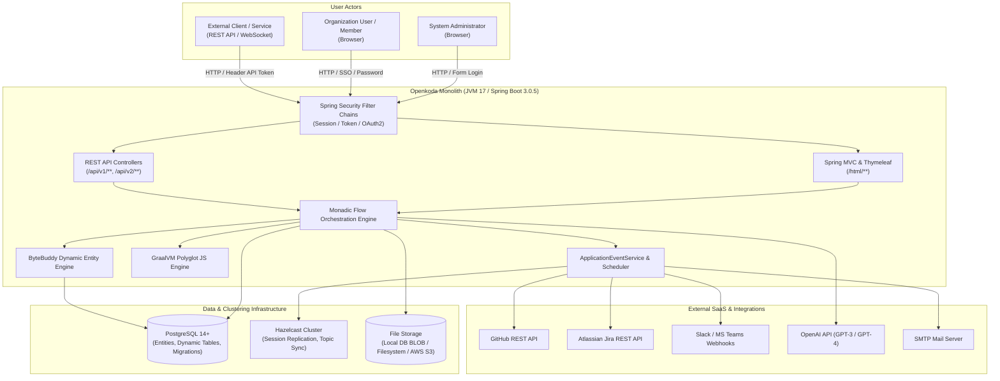
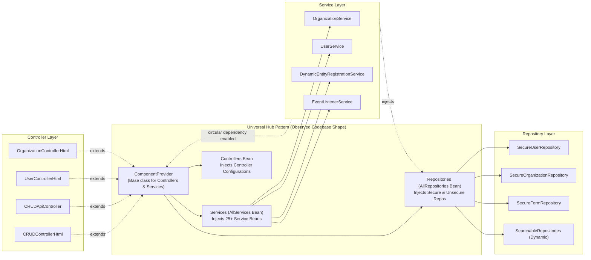
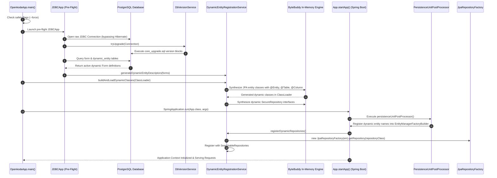
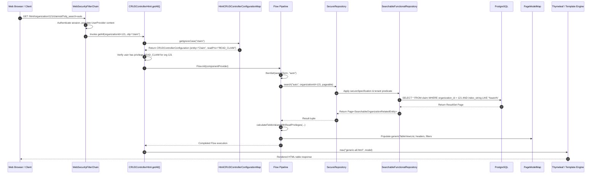
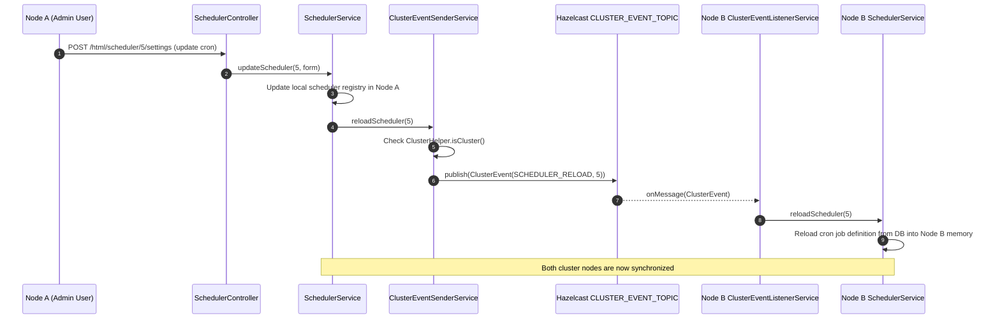

# Openkoda — Architectural Diagrams

This document visualizes the system context, modular decomposition, dependency graphs, and runtime execution sequences of the Openkoda platform derived directly from repository evidence.

---

## 1. System Context & External Dependencies

The following diagram illustrates Openkoda's boundaries, user actors, and integrated external infrastructure systems.

---

## 2. Main Modules & Architectural Responsibilities

This diagram maps the layered architectural tiers and responsibilities established in the codebase.

```mermaid
flowchart TD
    subgraph PresentationTier ["1. Presentation Tier (UI & Client State)"]
        ThymeleafEngine["Thymeleaf Engine"]
        DynamicResolver["FrontendResourceOrClassLoaderTemplateResolver"]
        HTMLTemplates["HTML5 / Thymeleaf Templates & Layouts"]
        PageModel["PageModelMap & PageAttr View Models"]
    end

    subgraph InboundTier ["2. Inbound Interfaces (Transport)"]
        CRUDHtmlCtrl["CRUDControllerHtml (/html/{obj}/**)"]
        CRUDApiCtrl["CRUDApiController (/api/v1/{obj}/**)"]
        PageBuilderCtrl["PageBuilderController"]
        ComponentsCtrl["ComponentsController (YAML / ZIP)"]
        AdminCtrls["AdminLogsController & SystemHealthController"]
    end

    subgraph ApplicationTier ["3. Application / Orchestration Tier"]
        FlowMonad["Flow Pipeline Monad (then, thenSet, execute)"]
        TransactionalExec["TransactionalExecutor"]
        LiveCompProvider["LiveComponentProvider (JS Bridge)"]
        AppEventService["ApplicationEventService"]
    end

    subgraph PolyglotTier ["4. Scripting & Bytecode Synthesis"]
        JsRunner["JsFlowRunner (GraalVM Polyglot Context)"]
        DynamicEntityService["DynamicEntityRegistrationService"]
        ByteBuddyCompiler["ByteBuddy In-Memory Class Compiler"]
    end

    subgraph DomainTier ["5. Domain Core & Business Rules"]
        OrgEntity["Organization (Tenant Root)"]
        UserRoleEntity["User, Role & DynamicPrivilege"]
        DynamicEntityModel["DynamicEntity & Form Descriptors"]
        SpelRules["RuleSpelHelper (SpEL Expression Engine)"]
    end

    subgraph PersistenceTier ["6. Persistence & Data Access"]
        SecureRepo["SecureRepository & SearchableFunctionalRepository"]
        DynamicRepos["Dynamic Repositories (JpaRepositoryFactory)"]
        TenantResolverImpl["TenantResolver (CurrentTenantIdentifierResolver)"]
        DbVersion["DbVersionService (Pre-flight SQL Runner)"]
    end

    PresentationTier <--> InboundTier
    InboundTier --> ApplicationTier
    ApplicationTier --> PolyglotTier
    ApplicationTier --> DomainTier
    ApplicationTier --> PersistenceTier
    PolyglotTier --> PersistenceTier
    PersistenceTier --> DomainTier
```

---

## 3. Component & Module Dependencies (The ComponentProvider Hub)

This diagram details the dependencies between components, highlighting the universal `ComponentProvider` hub pattern and its relationship to controllers, services, and repositories.

> [!NOTE]
> The bidirectional reference between `Services`, `Repositories`, and `ComponentProvider` is the root cause for requiring `spring.main.allow-circular-references=true` in `application-openkoda.properties`.

---

## 4. Runtime Flow: Dynamic Entity Synthesis & Bootstrapping

Sequence of events executing during application initialization, demonstrating the two-stage boot pipeline:

---

## 5. Runtime Flow: Tenanted Read Request through Monadic Flow

Sequence diagram tracing an incoming HTTP GET request for a tenanted dynamic entity list:

---

## 6. Runtime Flow: Asynchronous Cluster Synchronization

Sequence diagram showing how metadata changes (e.g. an updated scheduler or event listener) are broadcast across a distributed cluster:

