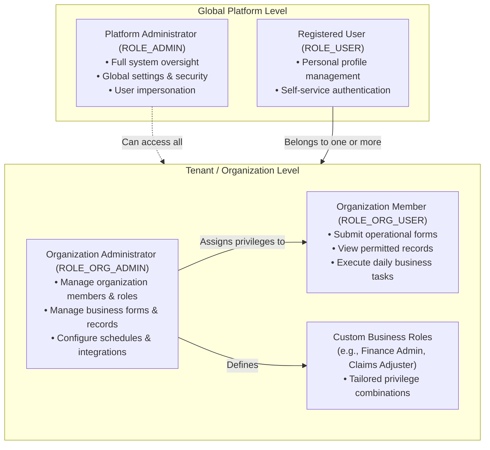
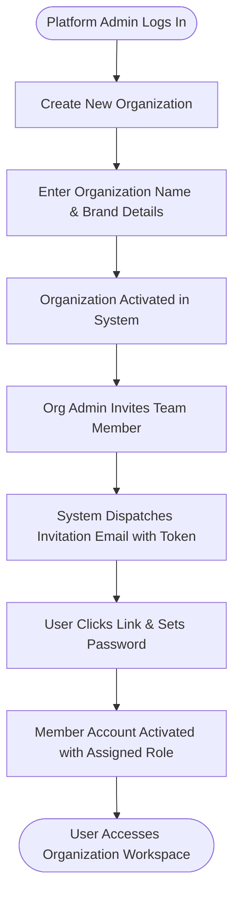
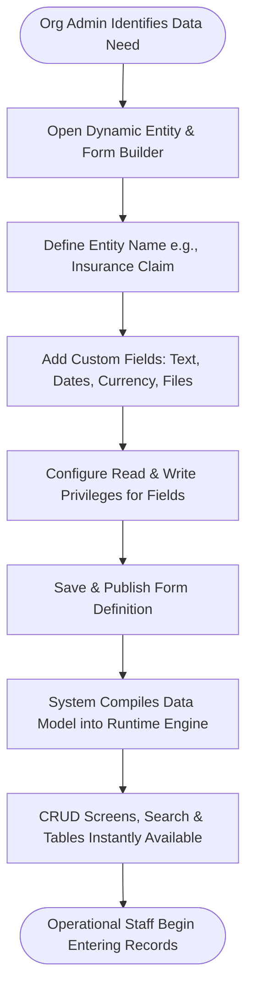
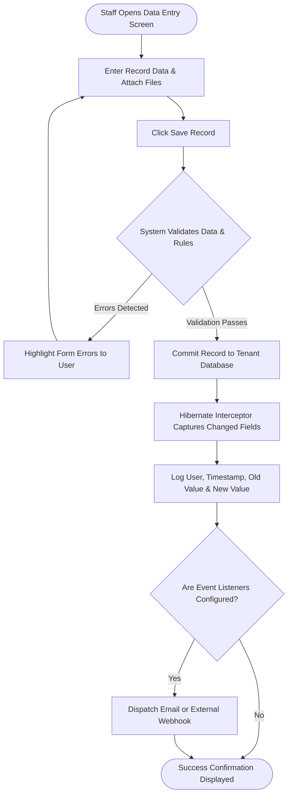
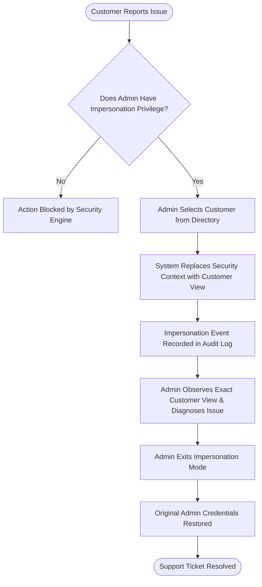
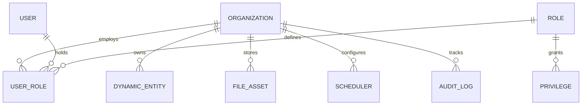

# Openkoda — Business Understanding Analysis

**Document**: `business-understanding.md`  
**Target Audience**: Business owners, product managers, business analysts, operational stakeholders, and onboarding team members  
**Analysis Date**: November 2026  
**Primary Application**: Openkoda Enterprise SaaS & Low-Code Platform (Version 1.7.1)  

---

## 1. Application Purpose

### 1.1 The Business Problem Addressed
Organizations building enterprise software, software-as-a-service (SaaS) products, or internal business portals typically encounter high overhead before delivering core business value. Standard enterprise requirements—such as organization tenancy, user onboarding, role-based access control, file storage, audit history, automated scheduling, report generation, and third-party integrations—traditionally consume months of custom development. Furthermore, when business models evolve, adding new entities, custom fields, or automated approval rules typically requires software recompilation, migration downtime, and developer intervention.

Openkoda addresses this by functioning as a **business application platform and runtime accelerator**. It provides an operational foundation with pre-built user management, multi-tenancy, data governance, and dynamic data modeling. This enables business teams and domain analysts to configure new data models, workflow rules, and web interfaces directly through an administrative portal, substantially shortening the time required to deploy enterprise solutions.

### 1.2 Enabled Business Activities
- **Multi-Tenant Account Management**: Onboard distinct commercial organizations or customer accounts, isolate their corporate data, and assign administrative control.
- **Member Collaboration & Access Governance**: Invite organizational staff, assign operational responsibilities (such as billing or member administration), and enforce granular data visibility.
- **Dynamic Business Data Modeling**: Define custom business forms, customer-specific records, and workflows (such as insurance claims, client policies, or project time logs) without requiring code recompilation.
- **Business Process Automation**: Configure scheduled routines (e.g., periodic reminders, data cleanup) and event-triggered actions (e.g., dispatching emails or webhooks when records change).
- **Executive Visibility & AI-Assisted Reporting**: Monitor system health, view audit histories of record changes, and query organizational datasets using plain-language questions translated into analytical reports.
- **Third-Party Collaboration**: Automatically propagate business notifications, issues, and customer communications to external platforms such as GitHub, Jira, Trello, Slack, and Microsoft Teams.

### 1.3 Intended Beneficiaries
- **Enterprise Product Teams & Startups**: Rapidly launch multi-tenant SaaS products by reusing production-ready administrative and security capabilities.
- **Operations & Business Analysts**: Create and modify operational forms, customer tables, and automation logic directly without waiting for software release cycles.
- **Tenant Administrators & Organizational Managers**: Oversee organizational staff, manage internal privileges, inspect operational records, and monitor member activities.
- **End Users & Customers**: Access secure, personalized self-service portals to complete business forms, submit support claims, review policies, or log work.

### 1.4 Scope Boundaries

| In Scope (Supported Business Capabilities) | Out of Scope (Not Handled by Application) |
| :--- | :--- |
| Multi-tenant organization isolation and member assignment | Dedicated payment gateway processing (e.g., native Stripe credit card vaulting is not embedded in the core runtime) |
| User authentication (passwords, social SSO, enterprise LDAP, API keys) | Standalone customer billing, invoicing cycles, or tax calculation engine |
| Role-based access control with granular privilege assignments | Native mobile application distribution (interface is responsive web) |
| Runtime dynamic form and entity definitions | Automated consumer dispute resolution or regulatory legal filing |
| Audit trail capturing before-and-after property modifications | Direct hardware device control or warehouse inventory scanning |
| AI-assisted conversational reporting and data table generation | Real-time voice or video communications |
| Exporting and packaging business solutions into portable ZIP archives | External marketing campaign automation or mass email newsletter management |

### 1.5 Stated Purpose vs. Inferred Purpose
- **Explicitly Stated Purpose** (from product documentation): Accelerate the delivery of enterprise applications and internal business tools by up to 60%; provide pre-built templates for Insurance Policy Management, Claims Management, and Time Tracking with zero vendor lock-in.
- **Inferred Purpose** (from repository implementation): Serve as an operational control plane and metadata-driven application host that allows a single software deployment to run multiple custom line-of-business applications simultaneously across isolated organizational boundaries.

---

## 2. Users and Roles

The application implements a two-tiered role hierarchy: **Global Roles** (platform-wide governance) and **Organization Roles** (tenanted operational administration).



### 2.1 Implemented Roles

#### 1. Platform Administrator (`ROLE_ADMIN`)
- **Who they represent**: Central IT managers, platform owners, or SaaS operating staff.
- **Primary Goal**: Maintain platform health, oversee all tenant organizations, configure system-wide security, and provide second-line technical support.
- **Allowed Actions**:
  - Access global configuration settings, view server logs, and monitor database health.
  - Create and manage tenant organizations.
  - Temporarily impersonate organizational users to troubleshoot customer support issues.
  - Access, export, or restore system backups.
- **Restrictions**: Administrative actions are captured in the system audit log.

#### 2. Organization Administrator (`ROLE_ORG_ADMIN`)
- **Who they represent**: A department head, business customer account manager, or tenant operational lead.
- **Primary Goal**: Administer day-to-day operations for their specific company or business unit.
- **Allowed Actions**:
  - Invite new employees or members to the organization by email.
  - Create custom roles and assign granular business privileges.
  - Build, modify, and publish custom business forms and data tables.
  - Configure scheduled business events and outbound integrations (such as Slack alerts or Jira tickets).
  - Query organization data and use AI reporting tools.
- **Restrictions**: Cannot view or modify data belonging to other tenant organizations; cannot access global system configuration.

#### 3. Organization Member (`ROLE_ORG_USER`)
- **Who they represent**: Operational employees, field agents, case workers, or staff members.
- **Primary Goal**: Carry out routine business workflows within their department or company.
- **Allowed Actions**:
  - Create, view, edit, or search business records (e.g., submit an insurance claim or enter a timesheet).
  - View organization dashboard metrics and announcements.
  - Upload supporting files and documents.
- **Restrictions**: Access to specific fields or forms is governed by explicit read/write privileges; cannot modify organization settings or user roles.

#### 4. Registered User (`ROLE_USER`)
- **Who they represent**: An authenticated individual who has an account on the platform but may not yet belong to an organization, or an external portal visitor.
- **Primary Goal**: Access personal account preferences, accept organizational invitations, or manage profile details.
- **Allowed Actions**: Update personal email, change passwords, and view invitations.
- **Restrictions**: Cannot view business records until assigned to an active organization.

### 2.2 Inferred User Personas
- **The Domain Analyst / Low-Code Builder**: An operations specialist who designs customer workflows, builds forms, and defines conditional SpEL rules without technical software engineering.
- **The External Partner / Auditor**: A compliance officer or external contractor granted read-only privileges across specific entity tables and audit logs.

---

## 3. Business Capabilities

```
+----------------------------------------------------------------------------------------------------+
|                                    OPENKODA BUSINESS CAPABILITIES                                  |
+----------------------------------------------------------------------------------------------------+
|  1. Organization & Tenancy Governance     2. User Identity & Access Management                     |
|  - Onboard customer organizations         - Self-registration & email verification                 |
|  - Isolate enterprise datasets            - Role & privilege configuration                         |
|  - Manage multi-org user memberships      - User impersonation for customer care                   |
+----------------------------------------------------------------------------------------------------+
|  3. Dynamic Data & Workflow Modeling      4. Business Process Automation                           |
|  - Build custom forms & tables            - Automated cron schedules (reminders, cleanup)          |
|  - Configure field-level permissions      - Event bus & listener triggers                          |
|  - Define conditional business rules      - Multi-node cluster synchronization                     |
+----------------------------------------------------------------------------------------------------+
|  5. Document & Media Management           6. Business Intelligence & AI Reporting                  |
|  - Upload & attach file assets            - Interactive analytical dashboards                      |
|  - Generate PDF documents from HTML       - Conversational AI reporting via OpenAI                 |
|  - Enforce file access permissions        - Tabular export & CSV data ingest                       |
+----------------------------------------------------------------------------------------------------+
|  7. External Enterprise Collaboration     8. Solution Packaging & Distribution                     |
|  - Outbound alerts (Slack, MS Teams)      - Export solutions as portable ZIP archives              |
|  - Issue sync (Jira, GitHub, Trello)      - Rapid deployment of pre-built business templates       |
|  - Secure API access for integrations     - Standardized component distribution                    |
+----------------------------------------------------------------------------------------------------+
```

### Capability 1: Organization & Tenancy Governance
- **What it enables**: Establishes distinct organizational boundaries, allowing multiple commercial clients or internal divisions to operate safely within the same platform instance.
- **Who uses it**: Platform Administrators and Organization Owners.
- **Trigger**: New commercial contract signed or new department onboarded.
- **Input Information**: Organization legal name, unique identifier, brand logo, default language, and isolation mode.
- **Expected Outcome**: An isolated tenant space created with dedicated administration settings and initial member roles.
- **Dependencies**: None (foundational capability).

### Capability 2: User Identity & Access Management
- **What it enables**: Secure authentication, invitation-based onboarding, single sign-on (SSO), and role-based privilege enforcement.
- **Who uses it**: All users, Organization Administrators, and Platform Administrators.
- **Trigger**: New employee hired, user self-registers, or administrator sends an email invitation.
- **Input Information**: Name, business email, initial role assignment, temporary password or invitation token.
- **Expected Outcome**: Active user account created, credentials verified, and permissions scoped to assigned organizations.
- **Dependencies**: Organization Governance.

### Capability 3: Dynamic Data & Workflow Modeling
- **What it enables**: Business users can model new data records (e.g., Insurance Policies, Vehicles, Invoices, Support Claims) with tailored input fields and validation constraints.
- **Who uses it**: Organization Administrators and Business Analysts.
- **Trigger**: New business product launch or operational requirement to collect and track data.
- **Input Information**: Entity name, field definitions (text, numbers, dates, references), required read/write privileges, and layout options.
- **Expected Outcome**: Instant creation of search screens, data entry forms, and relational storage accessible to authorized staff.
- **Dependencies**: User Access Management, Organization Governance.

### Capability 4: Business Process Automation & Scheduling
- **What it enables**: Executes recurring tasks on scheduled intervals (such as daily overdue notifications or nightly data archiving) and fires actions in response to record state changes.
- **Who uses it**: Organization Administrators and System Operators.
- **Trigger**: Elapsed time (cron trigger) or internal business event (record created, updated, or deleted).
- **Input Information**: Schedule expression (cron syntax), target event type, and action to execute (ServerJS script or notification dispatch).
- **Expected Outcome**: Automatic execution of operational workflows without manual staffing.
- **Dependencies**: Dynamic Data Modeling.

### Capability 5: Document & Media Management
- **What it enables**: Stores customer identity documents, policy attachments, contracts, and images; generates formal PDF certificates and reports.
- **Who uses it**: Operational Staff and Customers.
- **Trigger**: User uploads a file attachment or system triggers PDF generation upon form submission.
- **Input Information**: File payload, metadata, security access level, or HTML print template.
- **Expected Outcome**: Securely stored asset linked to a business record, or downloadable PDF generated.
- **Dependencies**: Organization Governance.

### Capability 6: Business Intelligence & AI Reporting
- **What it enables**: Operational dashboards, tabular reports, and natural-language querying that translates business questions into data visualizations.
- **Who uses it**: Executives, Managers, and Operational Leads.
- **Trigger**: User opens an analytics dashboard, requests an export, or submits a conversational data query.
- **Input Information**: Report filters, date ranges, or natural-language prompts.
- **Expected Outcome**: Tabular data displays, CSV exports, or AI-generated business summaries.
- **Dependencies**: Dynamic Data Modeling, User Access Management.

### Capability 7: External Enterprise Collaboration
- **What it enables**: Bridges the platform with existing enterprise collaboration ecosystems by automatically creating work tickets or posting channel messages when important events occur.
- **Who uses it**: Cross-functional operational teams.
- **Trigger**: High-priority alert triggered, support ticket escalated, or task assigned.
- **Input Information**: Third-party credentials, workspace IDs, channel names, and notification templates.
- **Expected Outcome**: Jira ticket created, GitHub issue logged, or Slack/Teams announcement dispatched.
- **Dependencies**: Automation & Scheduling, Dynamic Data Modeling.

### Capability 8: Solution Packaging & Distribution
- **What it enables**: Exports complete business configurations (data schemas, forms, automation scripts, and UI layouts) into portable ZIP packages that can be installed in other environments.
- **Who uses it**: Solution Architects, Product Managers, and Implementation Specialists.
- **Trigger**: Releasing a verified business workflow to production or packaging an industry template (such as the Insurance starter kit).
- **Input Information**: Target organization ID or selection of business components.
- **Expected Outcome**: Downloadable archive file ready for one-click deployment.
- **Dependencies**: Dynamic Data Modeling, Automation & Scheduling.

---

## 4. Main User Journeys and Business Processes

### 4.1 Process 1: Organization Onboarding and Team Member Invitation



- **Trigger**: New customer signs up or an existing tenant administrator invites a colleague.
- **Participating Roles**: Platform Administrator, Organization Administrator, Invited User.
- **Preconditions**: The inviting administrator must possess valid organization management privileges.
- **Main Steps**:
  1. The administrator submits the organization setup form with corporate branding and naming.
  2. The administrator navigates to the Member Directory and inputs the invitee's email address and assigned role (e.g., Member or Administrator).
  3. The system generates a secure, time-limited token and sends an invitation email.
  4. The invited user opens the link, completes their name, and creates a secure password.
  5. The platform establishes the user's membership and directs them to the organization dashboard.
- **Alternative Paths & Failures**:
  - *Email already registered in the organization*: System halts and displays an error indicating the user is already assigned.
  - *Expired invitation token*: System prompts the user to request a fresh invitation link from their administrator.
- **Final Outcome**: Invitee becomes an active member with access strictly confined to the organization's data.

---

### 4.2 Process 2: Creating and Publishing a Dynamic Business Entity



- **Trigger**: Business requires tracking a new operational entity (e.g., an equipment inspection, insurance claim, or customer ticket).
- **Participating Roles**: Organization Administrator, Operational Staff.
- **Preconditions**: Administrator possesses backend management privileges.
- **Main Steps**:
  1. The administrator navigates to the Form Management screen and specifies the entity name and associated database table.
  2. The administrator configures desired fields (e.g., `claimNumber`, `incidentDate`, `settlementAmount`, `damagePhotos`).
  3. The administrator sets visibility rules, specifying which roles can view or modify each specific field.
  4. The administrator saves the definition.
  5. The platform synthesizes the data model into the live runtime engine without system downtime.
  6. The navigation menu automatically reflects the new business object with search, filtering, and data entry forms.
- **Alternative Paths & Failures**:
  - *Field naming conflict*: The system validates that field names adhere to naming standards and prevents duplicates.
  - *Invalid formula*: SpEL calculations with syntax errors are rejected before saving.
- **Final Outcome**: A fully functional line-of-business module is immediately accessible to authorized staff.

---

### 4.3 Process 3: Submitting and Auditing a Business Record



- **Trigger**: An operational staff member submits a business transaction (e.g., updates policy status, files an expense).
- **Participating Roles**: Operational Staff, Audit Reviewer.
- **Preconditions**: User is authenticated and assigned write privileges for the target entity.
- **Main Steps**:
  1. User fills out the form and uploads supporting attachments.
  2. The system verifies input constraints (mandatory fields, formats, numerical ranges).
  3. The platform verifies user authorization against tenant ownership.
  4. The record is written to the tenant's data store.
  5. The audit subsystem inspects every modified field, recording the exact previous value, new value, modifier ID, and timestamp.
  6. If event triggers are registered for this entity, automated follow-on tasks (such as Slack alerts) fire asynchronously.
- **Final Outcome**: The business record is safely updated, fully audited, and viewable in compliance logs.

---

### 4.4 Process 4: Customer Support User Impersonation



- **Trigger**: An end customer encounters a workflow issue or displays incorrect data on their personalized dashboard.
- **Participating Roles**: Customer, Platform Administrator / Support Specialist.
- **Preconditions**: The administrative user must hold the explicit `canImpersonate` privilege.
- **Main Steps**:
  1. The administrator locates the customer in the User Management console.
  2. The administrator triggers "Impersonate User".
  3. The platform replaces the active session context with the customer's permissions and organizational tenancy.
  4. The system logs an unalterable security audit entry indicating that an impersonation session commenced.
  5. The administrator views the platform through the customer's lens to diagnose permissions, data discrepancies, or UI errors.
  6. The administrator terminates impersonation, instantly restoring their administrative identity.
- **Final Outcome**: Rapid customer issue resolution without requiring users to disclose passwords.

---

## 5. Business Rules and Policies

The application enforces policies governing security, tenancy, data integrity, and operational execution.

| Policy / Rule | When it Applies | Business Effect | Evidence Status |
| :--- | :--- | :--- | :--- |
| **Tenant Data Isolation Policy** | Every read, write, or search operation on an organizational entity. | A user belonging to Organization A can never inspect or alter data belonging to Organization B unless explicitly assigned cross-tenant privileges. | Confirmed |
| **Field-Level Privilege Enforcement** | Rendering table views, editing records, or processing API submissions. | If a user lacks the specific read privilege for a column (e.g., `settlementAmount`), that column is hidden from table views and excluded from API responses. | Confirmed |
| **Pre-Flight Initialization Safety Gate** | System bootstrapping or database initialization mode. | Prevents irreversible data loss by halting startup if an initialization script attempts to drop existing database tables without the `--force` flag. | Confirmed |
| **Mandatory Unique Account Email Policy** | User self-registration and member invitations. | No two users can share the same login email across the platform. | Confirmed |
| **Single-Organization Email Assignment Rule** | Adding or inviting users to an organization. | The system prevents adding a user with an email address that is already registered in that specific organization. | Confirmed |
| **Impersonation Audit Mandate** | Commencing or terminating a user impersonation session. | All actions undertaken while impersonating a customer are tracked under the administrator's identity for compliance and accountability. | Confirmed |
| **Audit Trail Immutability Policy** | Entity property creation, update, or deletion. | Whenever an audited record changes, the old value, new value, user ID, and timestamp are captured automatically; audit logs cannot be edited via standard UI. | Confirmed |
| **Session Inactivity Timeout Policy** | User browser sessions. | Inactive web sessions expire after 120 minutes of inactivity, requiring re-authentication to protect sensitive data. | Confirmed |
| **File Upload Size Limitation Policy** | Uploading file attachments or media assets. | Files exceeding 5 MB per individual file or multipart request are rejected to preserve bandwidth and storage limits. | Confirmed |
| **Asynchronous Event Worker Pool Policy** | Dispatched background events and notifications. | Background tasks are queued and processed across 4 worker threads, preventing heavy external integrations from degrading user interface responsiveness. | Confirmed |

---

## 6. Important Business Information

The platform operates around core business entities and conceptual relationships:



### 6.1 Key Business Concepts in Plain Language

1. **Organization (Tenant)**:
   - *What it represents*: A distinct commercial entity, client company, franchise, or corporate division.
   - *Lifecycle*: Created by platform administrators; activated; customized with branding and rules; archived or terminated.
   - *Relationships*: Owns member assignments, dynamic data records, file assets, and event configurations.

2. **User**:
   - *What it represents*: An individual person accessing the platform (employee, client, or system administrator).
   - *Lifecycle*: Invited -> Registered / Verified -> Active -> Suspended / Deactivated.
   - *Relationships*: May belong to multiple organizations simultaneously with different roles in each.

3. **Role & Privilege**:
   - *What it represents*: A business role (such as "Claims Adjuster" or "HR Manager") bundled with specific capabilities (such as "Read Reports", "Manage Users", or "Verify Claims").
   - *Lifecycle*: Defined by administrators; assigned to users; updated as organizational responsibilities change.

4. **Dynamic Entity & Form**:
   - *What it represents*: A custom business object configured by administrators (e.g., Insurance Policy, Customer Quote, Work Log, Incident Report).
   - *Lifecycle*: Drafted in Form Builder -> Published into Runtime -> Populated by Users -> Archived.

5. **Audit Record**:
   - *What it represents*: An immutable compliance record documenting every change made to a business entity.
   - *Contents*: Target entity ID, attribute name, previous value, new value, modifying user, and exact timestamp.

6. **File & Media Asset**:
   - *What it represents*: Electronic documents (PDFs, images, spreadsheets) attached to business transactions.
   - *Storage*: Stored either in the secure database or in cloud storage with access governed by entity ownership.

7. **Scheduled Job & Event Listener**:
   - *What it represents*: Automated operational routines (e.g., sending weekly summaries, synchronizing status with external ticketing systems).

---

## 7. Outputs and Business Visibility

The platform provides operational visibility and exportable business records:

### 7.1 Interactive Dashboards
- **Global Administrative Dashboard**: Displays system-wide operational metrics, health indicators, database version status, and server diagnostic logs for platform operations staff.
- **Organization Dashboard**: Provides a personalized workspace for tenant members, displaying accessible business modules, pending tasks, recent announcements, and navigation shortcuts.

### 7.2 Reports & Business Intelligence
- **AI-Powered Natural Language Reports**: Business users can type conversational questions (e.g., "Show me all approved claims over $10,000 this quarter") and the integrated OpenAI engine translates the inquiry into a structured data table.
- **Query Report Builder**: Allows administrators to define reusable parameterized business queries and render them as interactive data grids with column sorting and search.

### 7.3 Documents & Formal Outputs
- **PDF Document Generation**: Converts HTML templates populated with live transaction data into branded PDF documents (such as insurance policy schedules or payment receipts).
- **Tabular CSV Data Exports**: Allows operational users to export any data table to CSV for spreadsheet analysis or external compliance reporting.
- **Component ZIP Distribution Packages**: Generates packaged archives containing complete business modules (forms, rules, UI templates, scripts) for distribution between test and production environments.

### 7.4 Notifications & Alerts
- **Email Notifications**: Automated transactional emails for account invitations, password resets, and critical business alerts.
- **In-App Notification Dropdowns**: Real-time alerts visible within the application navigation bar notifying users of assigned tasks or status updates.

---

## 8. External Business Interactions

The platform connects with external business applications to avoid isolated data silos:

| External System | Purpose of Interaction | Exchanged Business Information | Business Process Dependency | Failure Handling |
| :--- | :--- | :--- | :--- | :--- |
| **Atlassian Jira** | Automatic issue tracking and software bug ticketing. | Issue title, description, priority, project key, issue type. | Escalation of support claims or technical bugs to engineering. | Logged as integration warning; does not block internal record creation. |
| **GitHub** | Developer task synchronization and bug filing. | Repository owner, repo name, issue title, notification body. | Developer incident response and code change tracking. | Logged in integration audit log; retried on demand. |
| **Trello** | Lightweight task management and card movement. | Board ID, list ID, card title, task checklist items. | Field operations and project task assignment. | Failure captured in application logs; user alerted. |
| **Slack & MS Teams** | Operational team messaging and urgent broadcast alerts. | Formatted channel messages, notification summaries, deep links. | Real-time incident awareness and operational notifications. | Asynchronous delivery failure logged without interrupting workflow. |
| **OpenAI (ChatGPT)** | Conversational business intelligence and query synthesis. | Data schema definitions (excluding sensitive values), user question. | AI-assisted reporting and automated query creation. | Fallback to manual SQL query creation if API is unreachable. |
| **SMTP / Mailgun** | Transactional email delivery. | Recipient email, subject line, templated HTML/plain-text email body. | User registration, password recovery, invite onboarding. | SMTP delivery exception logged; users can trigger "Resend Verification". |
| **AWS S3** | Cloud document storage. | File binary streams, MIME types, file keys, encryption headers. | Storing high-volume customer documents and media attachments. | Storage error returns HTTP 500 to user; prevents corrupt metadata. |

---

## 9. Business Impact and Risks

### 9.1 Operational Bottlenecks & Failure Modes
- **Unrestricted Script Execution Risk**:
  - *Observed Behavior*: The embedded scripting engine allows ServerJS scripts to access broad underlying system capabilities.
  - *Business Risk*: If non-superadmin users are inadvertently granted script creation privileges, an unreviewed script could perform unauthorized operations, potentially affecting platform stability.
- **Invitation & Onboarding Blockages**:
  - *Observed Behavior*: Account creation and password resets depend on external SMTP email delivery.
  - *Business Risk*: Misconfigured SMTP settings silently stall employee onboarding, requiring administrator intervention to manually copy invitation links.
- **Transaction Hold Times on Web Requests**:
  - *Observed Behavior*: Certain entity save operations bind database transactions directly to web requests.
  - *Business Risk*: During peak business hours with heavy traffic, slow network clients could hold database connection pool slots, degrading responsiveness across the entire organization.
- **Single Point of Configuration in Mega-Aggregator Hub**:
  - *Observed Behavior*: Platform services, repositories, and controllers are centrally bound in a shared provider hub with circular references allowed.
  - *Business Risk*: A regression or syntax error in one operational module has the potential to prevent other unrelated modules from initializing properly.

---

## 10. Open Business Questions

The following questions cannot be conclusively resolved through static codebase inspection alone and require input from business stakeholders:

| # | Topic / Question | Inspected Evidence | Business Importance | Suggested Clarifier | Status |
| :--- | :--- | :--- | :--- | :--- | :--- |
| **Q1** | **Multi-Schema vs. Shared-Schema Production Standard**<br/>Is the multi-schema isolation mode (`org_<id>`) actively used for commercial tenants, or is shared-schema with row-level filtering the sole production standard? | `MultitenancyService.java`, `application-openkoda.properties` | Directly affects customer compliance assertions regarding physical vs. logical data segregation. | Product Manager / Lead Architect | Needs confirmation |
| **Q2** | **AI Reporting Data Governance Boundaries**<br/>Are database schema descriptions sent to OpenAI during AI reporting sanitized to ensure customer-specific metadata is never transmitted externally? | `ChatGPTService.java`, `openkoda-app/pom.xml` | Critical for enterprise compliance with privacy standards and non-disclosure agreements. | Security Officer / Compliance Lead | Needs confirmation |
| **Q3** | **Default Storage Strategy for Sensitive Documents**<br/>What proportion of customer deployments rely on database BLOB storage vs. AWS S3? | `FileService.java`, `application-openkoda.properties` | Influences database backup sizes, disaster recovery time objectives, and storage costs. | DevOps / Infrastructure Lead | Needs confirmation |
| **Q4** | **Commercial Payment Integration Intent**<br/>Are payment entities (`PaymentDto`, `payment.yaml`) intended to connect to external gateways (e.g., Stripe, Adyen) or merely track manual ledger receipts? | `examples/insurance/src/.../payment.yaml`, `PaymentDto.java` | Affects billing automation roadmaps and PCI-DSS compliance scope. | Product Owner | Needs confirmation |
| **Q5** | **Pre-Built Template Support Scope**<br/>Are the Insurance and Time-Tracking templates intended as reference demonstrations or commercially supported product editions? | `examples/insurance/`, `examples/timelog/`, `README.md` | Governs release SLAs, customer support commitments, and documentation obligations. | Product Manager | Needs confirmation |

---

## 11. Business Glossary

- **Tenant**: An isolated customer account or organization space operating independently on the shared platform.
- **Organization**: The primary administrative entity representing a business tenant or company on Openkoda.
- **Organization Admin (`ROLE_ORG_ADMIN`)**: An operational lead who manages members, roles, forms, and settings within a single organization.
- **Platform Admin (`ROLE_ADMIN`)**: An IT or system administrator with unrestricted oversight across all tenants and server configurations.
- **Dynamic Entity**: A customizable business record type (e.g., Claim, Policy, Project) configured at runtime without software recompilation.
- **Form Builder**: The administrative interface used to define data fields, input layouts, and validation rules.
- **Flow**: The internal execution pipeline that guides business data through validation, calculation, persistence, and presentation.
- **Impersonation**: A secure administrative feature allowing authorized staff to view the platform through a specific customer's perspective for support diagnostics.
- **Audit Log**: An immutable, chronological record detailing who modified an entity, what changed, and when the change occurred.
- **ServerJS**: Server-side JavaScript scripts written by administrators to execute custom business calculations and automation.
- **Frontend Resource**: A dynamic web page, layout fragment, or stylesheet stored in the database and rendered to users on demand.
- **Component Archive (ZIP)**: A portable package containing forms, rules, templates, and scripts that can be exported and imported between Openkoda instances.

---

## 12. Evidence Appendix

This appendix maps the business findings and claims in this document to specific files, symbols, and line ranges in the repository.

| Claim / Business Capability | File Path | Symbol / Configuration Key | Line Reference | Evidence Status |
| :--- | :--- | :--- | :--- | :--- |
| **Multi-Tenancy & Tenant Creation** | `openkoda/src/main/java/com/openkoda/core/multitenancy/MultitenancyService.java` | `createTenant(long organizationId)` | Lines 60–120 | Confirmed |
| **Thread-Local Tenant Resolution** | `openkoda/src/main/java/com/openkoda/core/multitenancy/TenantResolver.java` | `resolveCurrentTenantIdentifier()` | Lines 42–100 | Confirmed |
| **Role Hierarchy & Privilege Enumeration** | `openkoda/src/main/java/com/openkoda/model/Privilege.java` | `enum Privilege` | Lines 32–83 | Confirmed |
| **User Impersonation Capability** | `openkoda/src/main/java/com/openkoda/model/Privilege.java` | `canImpersonate` | Line 51 | Confirmed |
| **Dynamic Entity Bytecode Compilation** | `openkoda/src/main/java/com/openkoda/service/dynamicentity/DynamicEntityRegistrationService.java` | `buildAndLoadDynamicClasses(ClassLoader)` | Lines 104–142 | Confirmed |
| **Dynamic Form Persistence & Loading** | `openkoda/src/main/java/com/openkoda/JDBCApp.java` | `main(String[] args)` (queries `form` & `dynamic_entity`) | Lines 83–108 | Confirmed |
| **Pre-Flight Safety Check (`--force`)** | `openkoda/src/main/java/com/openkoda/App.java` | `initializationSafetyCheck(boolean isforce)` | Lines 99–120 | Confirmed |
| **In-Process Container Restart** | `openkoda/src/main/java/com/openkoda/App.java` | `restart(boolean reloadAllForms)` | Lines 131–163 | Confirmed |
| **Database-Stored Thymeleaf Templates** | `openkoda/src/main/java/com/openkoda/core/configuration/FrontendResourceOrClassLoaderTemplateResolver.java` | `computeTemplateResource(...)` | Lines 57–120 | Confirmed |
| **GraalVM Polyglot Host Access** | `openkoda/src/main/java/com/openkoda/uicomponent/JsFlowRunner.java` | `contextBuilder` (`allowHostAccess(HostAccess.ALL)`) | Lines 53–57 | Confirmed |
| **Audit Logging Hibernate Interceptor** | `openkoda/src/main/java/com/openkoda/core/audit/PropertyChangeInterceptor.java` | `onFlushDirty(...)` | Lines 48–75 | Confirmed |
| **Session Inactivity Timeout (120m)** | `openkoda/src/main/resources/application-openkoda.properties` | `server.servlet.session.timeout=120m` | Line 78 | Confirmed |
| **File Upload Size Limit (5MB)** | `openkoda/src/main/resources/application-openkoda.properties` | `spring.servlet.multipart.max-file-size=5MB` | Lines 41–42 | Confirmed |
| **Asynchronous Worker Thread Pool (4 Threads)** | `openkoda/src/main/java/com/openkoda/core/service/event/ApplicationEventService.java` | `asyncEventsExecutor` | Line 49 | Confirmed |
| **Hazelcast Cluster Topic Synchronization** | `openkoda/src/main/java/com/openkoda/core/service/event/ClusterEventSenderService.java` | `CLUSTER_EVENT_TOPIC` | Lines 39–92 | Confirmed |
| **GitHub Issue Outbound Integration** | `openkoda/src/main/java/com/openkoda/integration/consumer/GitHubIntegrationConsumers.java` | `createGitHubIssueFromOrgNotification(...)` | Lines 51–82 | Confirmed |
| **OpenAI ChatGPT Reporting Service** | `openkoda/src/main/java/com/openkoda/service/openai/ChatGPTService.java` | `ChatGPTService` | Entire file | Confirmed |
| **Insurance Industry Template Schemas** | `examples/insurance/src/main/resources/components/form/` | `claim.yaml`, `policy.yaml`, `quote.yaml`, `agent.yaml` | Directory listing | Confirmed |
| **Component ZIP Export Capability** | `openkoda/src/main/java/com/openkoda/controller/ComponentsController.java` | `exportAllResourceToZippedYamls()` | Lines 46–58 | Confirmed |
| **Universal ComponentProvider Hub** | `openkoda/src/main/java/com/openkoda/controller/ComponentProvider.java` | `public class ComponentProvider` | Lines 44–60 | Confirmed |
| **Circular Bean Reference Allowance** | `openkoda/src/main/resources/application-openkoda.properties` | `spring.main.allow-circular-references=true` | Line 22 | Confirmed |
